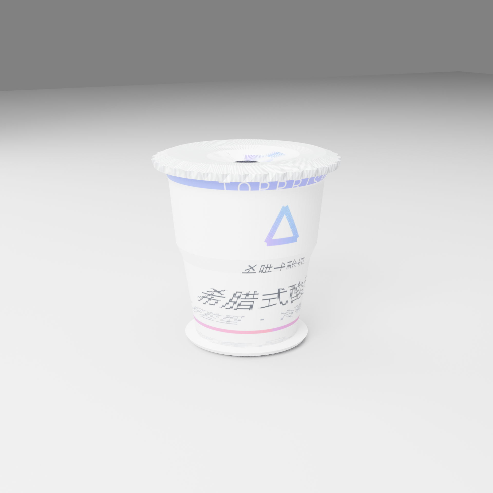
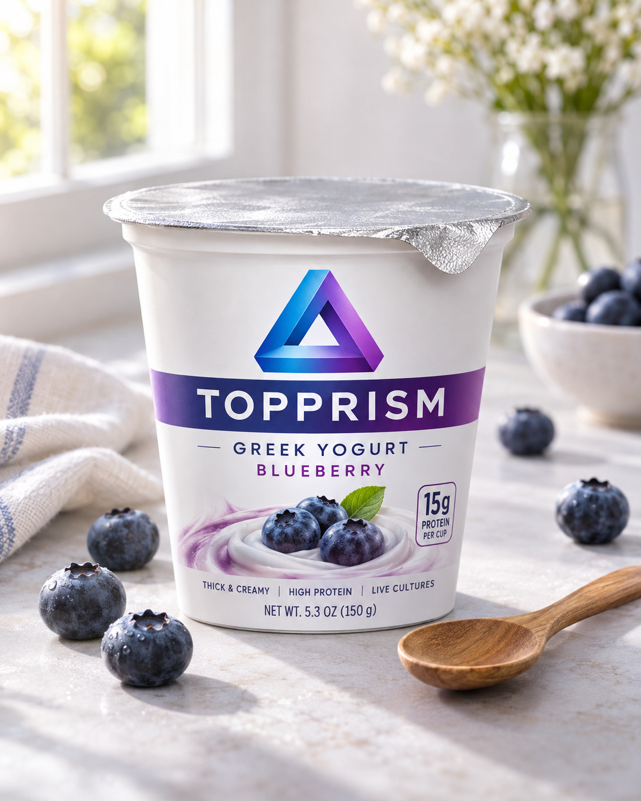
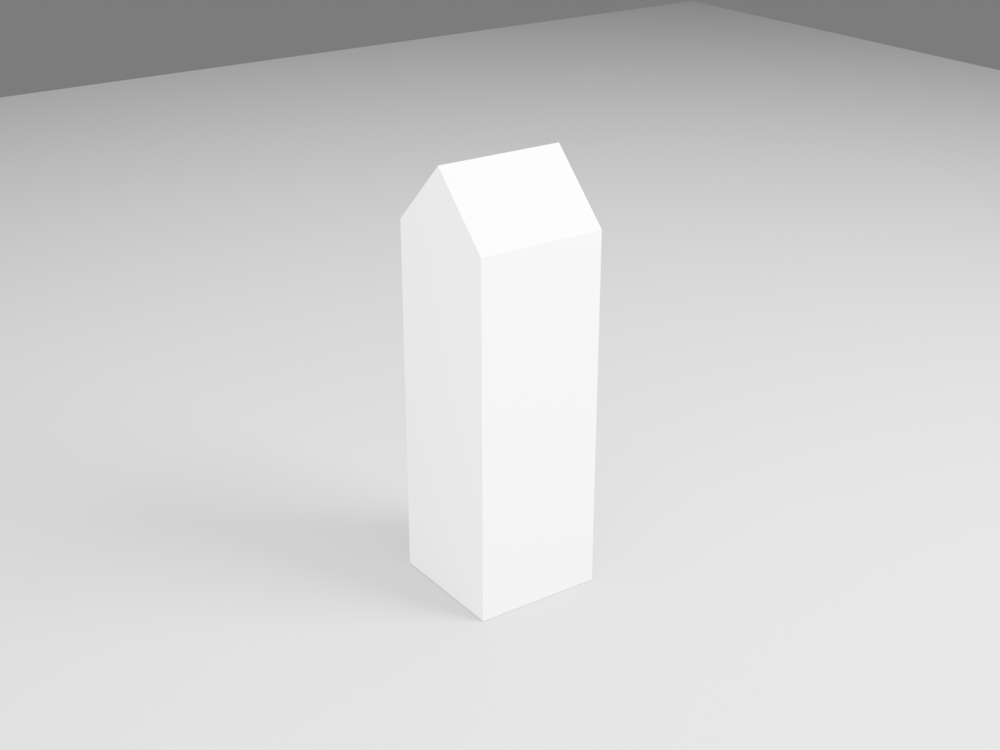
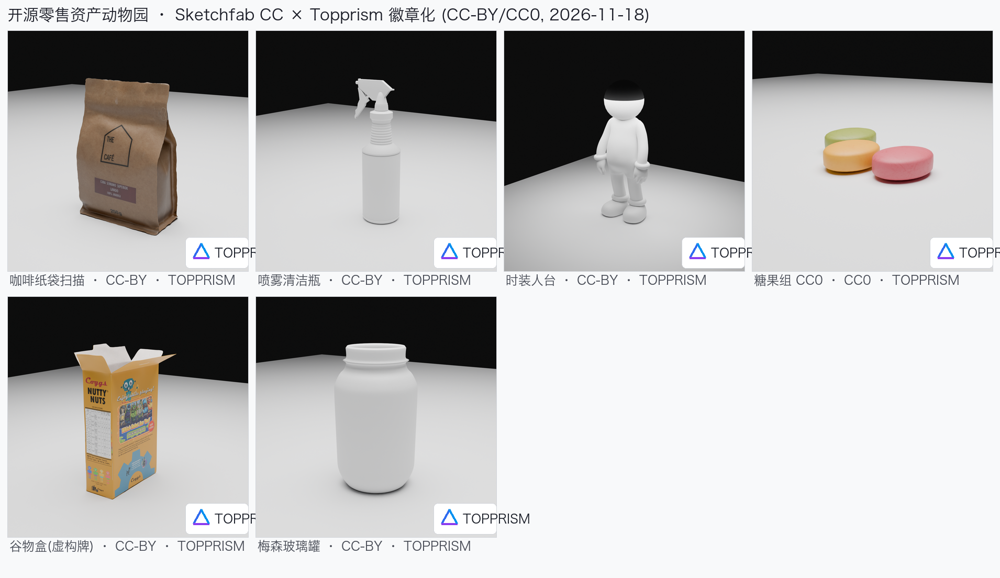

# OpenUSD 零售商品数字孪生与视觉 AI 研究仓

零售包装数字孪生的完整研究仓：**OpenUSD 数字母本 + Blender/Cycles 商业级渲染 + 货架 SDG 合成数据 + YOLO 训练评测闭环**。已在 **macOS (Apple Silicon / Metal)** 与 **Windows (NVIDIA / OptiX·CUDA)** 上真机验证（见 `docs/CROSS_PLATFORM_MIGRATION.md`）。
对外展示资产使用自有品牌 **Topprism® 虚拟产品**（虚拟演示 SKU，非在售）。

> **公开仓库资产与知识产权边界**：本仓库公开的**产品包装、品牌标识与商品配置**均为本仓自建的虚拟演示内容（Topprism® 虚拟 SKU），不代表任何客户品牌、在售商品或商业合作关系；公开版本不包含客户提供的原始产品照片、品牌印刷文件、包装刀版及其他未获公开授权的客户专属素材（相关路径已在 `specs/` 中去标识化）。
> **第三方素材例外**：`assets/` 下另有第三方模型/贴图/HDRI（Sketchfab CC-BY-4.0、Poly Haven CC0、InnerScene CC0 等），按其原始许可使用，**必须署名**，逐项见 `docs/ASSET_CREDITS.md` 与 `NOTICE.md`。
> **使用边界**（2026-11-19 审计，2026-11-21 按许可原文收紧）：①第 ④/④′ 项结论建立在 **SKU-110K 代理数据集**上，且四臂中有三臂是本仓自身组件 —— **可用于学术对比，但不能外推为真实门店/真实 SKU 的效果**，论文里请写清 baseline 与协议；②该数据集上游许可原文为「仅供学术与非商业用途」，并**明确禁止分发/提供访问、禁止制作照片的衍生作品**（逐字条款与本仓的处理见 `docs/research/DATASET_SKU110K.md`）——因此**数据集、派生标签与图像一律不入仓**，仓内只有 split 名单、指纹与指标；若日后用于商业交付或客户提案，须换用可商用数据集复跑；**模型权重是否构成"衍生作品"许可文本未界定，本仓的选择是不把权重入库**（只留 sha256），若论文要发布权重请自行评估；③仓内 `assets/models/sneaker_trellis/PROVENANCE.json` 记录了一个许可待核的图库输入图（**该图本身不在仓内**，仅来源记录在仓）。
> **离线声明更正**：除扩散模型臂（`22_controlnet_finish.py`、`pilot_r2.py` 需下载 SD1.5 / ControlNet 权重）外，其余管线可离线运行。

## 🧊 Topprism® 虚拟产品线（公开展示资产）

<p align="center">
  
  
</p>
<p align="center">
  
</p>

**「Topprism 希腊式酸奶 · 蓝莓 160g」（虚拟演示 SKU）**：设计母题=棱镜色散，蓝紫渐变三角 logo（#2F6BF0→#8B3CF0→#0090F0），标签/盖膜强制印制「虚拟演示产品 · 非销售品」。

- **程序化标签** `pipelines/topprism_virtual/32_topprism_yogurt_label.py` — PIL 矢量生成 2048×560 杯面实比贴图（中英混排/光谱条/占位条码）
- **参数化建模 + 渲染** `pipelines/topprism_virtual/33_topprism_yogurt_cup.py` — bmesh 锥度杯体 + 铝箔拱顶褶边盖，Cycles/Metal 1920px/256s（关 OIDN 保印刷笔画锐度）
- **AI 生活方式场景图** — ChatGPT relay 文生图早餐场景，品牌字样可读、无几何穿帮
- 详见 **[docs/GITHUB_SHOWCASE.md](docs/GITHUB_SHOWCASE.md)**

## 📁 研究案例

**① 参数化包装管线（公开 CC0 刀版核验协议）**
<p> </p>
左：CC0 公开刀版渲染参照；右：本仓 `pipelines/pack_dieline/` 标准管线生成。三级核验（许可原文/SSR 提取/2D 拓扑比对），spec JSON 声明 + 运行时几何求解。见 `docs/pack/gable_reference_benchmark.md`。

**② 商业棚拍级生活方式渲染**
以真实在售电商图为风格标尺校准的棚拍复刻线：f/5.6 + 9:1 光比 + 确定性噪声晶格（跨进程逐位一致）、11/11 门禁 + 8/8 接触影、真实扫描食材资产（蓝莓 CC-BY / 牛角包 CC0）入景。**同标尺盲评得分 27 vs 25（一次会话、单个评分者、无 rubric 存档）——按本仓自身的判官漂移记录（±1~3 分），该差值落在噪声内，不能作为「超过参照真图」的结论**；结论边界见 `docs/JUDGE_VALIDATION_P0C.md`。

**③ 货架 SDG + AI 巡检闭环**
零人工标注：相机射线网格像素级标签（负向对照验证）→ YOLOv11n 训练（MPS / CUDA 自动选择）→ 巡检仪表盘（OSA/合规率 KPI）。**产能已改为实测**：2026-11-20 在 Windows / GTX 1050 Ti / OptiX / 1440×1080 / 64 samples / bays=1 下实测 **22.7 s/图 → 2.64 图/min**（逐图计时落 `output/sdg_shelf/split_manifest.json` 的 `throughput`）；2026-11-21 同机再测一批（200 图 / 场景级留出 / 4 图每场景）**20.34 s/图 → 2.95 图/min**（4,068 s / 200 图，含渲染 + 射线标注）。此前的「3.6 图/min（bays=3 多联墙）」是经验值，未落盘计时；**1 万图仍属水平外推，非实测**。

**④ 合成 vs 真实四臂实证（公开数据集 SKU-110K，协议哈希存证）—— 含一处协议口径修正**
**⚠️ 2026-11-23/24：四臂补了多 seed 复跑（R0/R2 各补 seed 43/44/45/46/47，R1 补到 42），原来那句写法要改。** 已发布的四臂是 2026-11-08 macOS/MPS 那一版，其中 **R1/R2 的合成数据此后换过**（旧划分 → 场景级留出），所以那一对**不是 seed 复跑**，"Δ = −1.77pp ≤ 2pp 擦边通过"只能当**历史协议的观测值**引用。当前协议下同 seed 配对复跑（**n=5**）：R0 真实 **0.8817 / 0.8846 / 0.8833 / 0.8835 / 0.8824**（mean 0.8831 ± 0.0011）、R2 真实+合成 **0.8828 / 0.8850 / 0.8857 / 0.8857 / 0.8840**（mean 0.8847 ± 0.0012）→ **Δ(R2−R0) = +0.11 / +0.04 / +0.25 / +0.23 / +0.17 pp，mean +0.16pp，95% CI [+0.05, +0.26]** → **CI 整段在 0 以上 = 差值显著为正**（95% 置信下至少高 0.05pp），5 个 seed 的差值**全部为正**、方向一致 → 追加 160 张合成**没有损害**基线，严格说还**略微优于**基线（幅度很小：+0.16pp）（比原来"≤2pp 擦边通过"更强，也更诚实：那个 2pp 阈值的余量 0.23pp 其实小于臂间 seed 波动）。R1 纯合成：当前协议 **0.2265 / 0.2437 / 0.2532 / 0.2294 / 0.2598 / 0.2436**（mean 0.2427 ± 0.0130，seed 42–47；历史协议那个 0.1330 是旧合成划分的值）→ **比 R0 低 63.7pp，CI [−65.10, −62.33]**，"跨域纯合成不可用"的负结论不变。**结论边界**：该实验只支持「向全真实训练集追加少量合成数据未损害基线」；「合成可替代大规模手工标注」**已由 ④′ 的标注预算臂单独测量，结论为负**。**标注口径差已量化（2026-11-23，审计 F7）**：合成标签与真实标签的口径差（可见区域紧致框 vs 整品框、丢 OOS gap 框 15.7%、框密度差 6.7×）**最多只能污染 R2 训练信号里 1.91% 的那部分**（合成占训练集的比例）→ 量级上不可能解释"未检出差异"；而审计原文说的"合成丢弃遮挡物"在这套实际数据上**一次都没发生**（可见度过滤丢弃 0/5240）。详见 `docs/research/benchmark/label_semantics.md`。评测集 n 与划分**已可核验**（SKU-110K 指纹入 `docs/research/DATASET_SKU110K.md`）。R1 负结果的根因原写"指向训练/真实密度错配但仓内不可核验"，**现已落盘量化**：合成 21.8 框/图 vs 真实 147.0 框/图，见 ④′ 的 `domain_gap_measure.json`。产物：`docs/research/benchmark/fourarm_seed_variance.md`（`36_fourarm_seed_variance.py` 现算）。报告：[docs/research/benchmark/](docs/research/benchmark/)；判读边界：[docs/research/AUDIT_FOUR_ARM_2026-11-18.md](docs/research/AUDIT_FOUR_ARM_2026-11-18.md)。

**④′′ 域对齐臂的协议对齐复跑（2026-11-23）——「域对齐」不是不充分，是在本域有害**
已发布的 R3-full（纯合成 + 域对齐配方 cam1.6/lens40/misalign0.35/bays5）**不可复现**：协议记录与实际训练配置矛盾，合成集是已被覆盖的旧划分，图数（400）也与当前协议（160）不同。`38_r3_protocol_matched.py` 把它重做成**只差一个变量**的臂（同 200 图、同场景级留出、同标签语义、同训练协议、多 seed），对照组 = 同配方的 R1。**结果：域对齐配方显著更差** —— R3pm **0.1895 / 0.1359 / 0.1764 / 0.0704 / 0.0830 / 0.2056**（mean 0.1435 ± 0.0568，seed 42–47）vs R1 **0.2265 / 0.2437 / 0.2532 / 0.2294 / 0.2598 / 0.2436**（mean 0.2427 ± 0.0130）；按 seed 配对 Δ(R3pm−R1) = **−3.70 / −10.78 / −7.67 / −15.90 / −17.68 / −3.81 pp（n=6），mean −9.92pp，95% CI [−16.18, −3.67]** → **CI 全部在 0 以下，显著变差**。**机理（域差距三因子，同一套度量）**：框密度 21.83 → **30.00**（真实 147.04，更近 ✅）、平均框面积 0.0053 → **0.0038**（真实 0.0030，更近 ✅）、中位宽高比 0.3232 → **0.3007**（真实 **1.0544**，**反而更远** ❌）；同时 misalign 0.35 把**错位商品占保留框的比例从 12.3% 推到 42.2%**（3.4×）——这些框单类化后仍算"商品"，训练信号里 42% 是倾斜商品，而真实货架是直立/横放混合 → 学到错的方向先验。**⚠️ 2026-11-23 晚订正（诊断写错过，已改）**：先前这里写的是"本项目的 SDG 生成器无法正确表达域对齐"——**这个说法是错的**。复盘发现：(a) R3-full 配方的"域对齐"只调了镜头/错位率/bays，**从没调过商品形状**（朝向因子）；misalign 0.35 是**绕竖轴转 82°**（面朝错），只把投影宽高比从 0.353 压到 0.324 —— 所以"朝向因子变差"是**没操作**的结果，不是"操作了反而更糟"；(b) 朝向因子在生成器里**是能表达的**——商品箱子长宽就是参数（`PACK_W 0.048 × PACK_H 0.136`），实测真实域逐图中位宽高比 **1.05** vs 合成 **0.32**（3.3 倍）、单框面积 0.0029 vs 0.0053。已加**形状先验**（按真实域经验分布采样每个商品的投影宽高比与面积，探针实测标定 `gain 1.214 / area_gain 0.782`，尺度因子已打到真实值 0.00279），由单独的臂回答"把朝向+尺度因子真的对齐过去有没有用"（脚本 41–43）。产物：`docs/research/benchmark/r3_protocol_matched.json`（脚本 38 现算）。

**④′′′ 形状先验臂（2026-11-23/24）——「把朝向+尺度真的对齐到真实侧」有效吗？**（**负结果**，但把"域对齐为什么失败"这个问题问到底了）
上一段的诊断是"R3-full 根本没调过朝向因子"，所以这里做一个**配方与 R1 完全相同、只多一个 `--shape-profile real`** 的臂（`43_r1shape_arm.py`）：按真实域的**投影宽高比分布 + 投影面积分布**给每个商品重采样长宽（探针 42 号逐框标定 `gain 1.214 / area_gain 0.782`）。**干预确实生效了**：逐图中位宽高比 **0.3196 → 0.7934**（真实 1.0544，|差| 从 0.73 降到 0.26）、单框面积 **0.0053 → 0.0031**（真实 0.0030，|差| 从 0.0023 降到 0.0001）——**朝向和尺度两个因子都显著靠近了真实侧**。**结果：mAP 反而更差**：R1shape **0.2068 / 0.1013 / 0.0964 / 0.1413 / 0.1014 / 0.1695**（mean 0.1361 ± 0.0450，seed 42–47）vs 同 seed 的 R1 **0.2265 / 0.2437 / 0.2532 / 0.2294 / 0.2598 / 0.2436** → 按 seed 配对 Δ(R1shape−R1) = **−1.97 / −14.23 / −15.68 / −8.81 / −15.84 / −7.41 pp，mean −10.66pp，95% CI [−16.48, −4.83]**（n=6，**CI 整段在 0 以下 → 显著更差**，6/6 个 seed 方向一致为负）。**结论（本项目关于 SDG 域对齐的最终判断）**：**"域对齐"这条路在本项目的 SDG 生成器上走不通，而且失败原因不是"没操作到位"**——把朝向和尺度都精确对准真实域之后，性能不但没改善、反而掉了 **10.66pp（95% CI [−16.48, −4.83]，n=6，6/6 个 seed 方向一致为负）**。机理上说得通：合成集与真实域的差距**不是"框的形状"能补的**——真实域 147 框/图 vs 合成 21.8 框/图（**7 倍密度差**）、分辨率/视角/遮挡结构完全不同；只对齐形状相当于给一个"数量与场景都不对"的集合换上正确的框形，学到的仍是跨域不可用的表征。**⚠️ 两条方法学订正（2026-11-24）**：①这个臂动的是**朝向+尺度两个因子**，不是单因子臂（原文写"面积保持不变"是错的，实测面积也变了 0.0053→0.0031）；②每图保留框 **21.83 → 20.63** 不是"干预污染了别的变量"，而是几何干预的**下游必然后果**（商品改宽 → 遮挡变多 → 可见度过滤 `vis_frac<15%` 丢弃的记录从对照臂的 **0%** 升到 **3.98%**）——密度是涌现量，不是旋钮。

| 域差距因子 | R1 对照 | **R1shape（形状先验）** | 真实域 | 干预是否生效 |
|---|---:|---:|---:|---|
| 朝向：逐图中位宽高比 | 0.3232 | **0.9272** | 1.0544 | ✅ 靠近（\|差\| 0.73 → 0.13） |
| 尺度：单框面积 | 0.0053 | **0.0031** | 0.0030 | ✅ 靠近（\|差\| 0.0023 → 0.0001） |
| 密度：框/图 | 21.83 | 20.63 | 147.04 | ⚠️ 涌现量（见下），仍差 7 倍 |
| **mAP@0.5（配对 Δ vs R1）** | — | **−10.66pp**，CI [−16.48, −4.83]（n=6，**显著**） | — | ❌ **更差** |

**④′′′′′ 密度因子首次直接实测（2026-11-24）——"密度是剩下的嫌疑"现在有尺寸了**
上一段形状臂的结论是"域对齐这条路走不通"，机理段落把**密度**列为剩下的嫌疑（真实 147 框/图 vs 合成 21.8 框/图，7 倍差），但那是**从负结果推断出来的，从来没有直接测过**。本段把它测了：在**真实数据侧**做密度稀释（`45_density_diagnostic.py`）——**图像像素完全不变**（直接链接原图），**框的尺度/朝向/位置分布也完全不变**（裁的是框的**数量**，不是框的样子），每图随机保留 22 个框（147.04 → 22.0，保留 15.0%），评测集仍是同一份真实 test（2,935 张 / 431,419 实例）：

| 训练集（图像与框的样子全同，只差框的**数量**） | seed 42 | seed 43 | seed 44 | mAP@0.5 均值 |
|---|---:|---:|---:|---:|
| 全量真实 147.04 框/图（基线，同协议） | 0.8862 | 0.8817 | 0.8846 | **0.8842** |
| 稀释到 22 框/图 | 0.8460 | 0.8395 | 0.8465 | **0.8440** |
| **配对差值** | −4.02 | −4.22 | −3.81 | **−4.02 pp，95% CI [−4.52, −3.51]（n=3，t=−33.9，sd 0.21）** |

**机制是"漏检"而不是"定不准"**（同一份 test 集 2,935 张，产物 `precision` / `recall` 字段）：precision **0.8853 → 0.8995（反而略升 +1.4pp）**、recall **0.8082 → 0.6964（−11.2pp）**、mAP50-95 0.5299 → 0.4849 —— 丢掉 85% 的标注 = 大量真实物体**从没被当成正样本**，模型压根没学过它们，自然检不出来；这同时证明干预**只动到了"数量"这一个变量**。
**三条由此得到的结论**：
1. **密度是真实的一个实质性因素，但不是全部**：4.02 pp 相当于 5% 预算下"合成→全量真实"缺口（9.92 pp）的 **~41%**；**其余 ~59% 在别处**（成像风格 / 框语义差异 / 图内布局），所以"域差距的主因是密度"这种说法**不成立**，本仓此前的表述只到"密度是嫌疑"为止，现在应改为"**密度解释了约四成，其余因素仍未定位**"。
2. **形状臂的 −10.66 pp 不是密度污染**：该臂的密度只从 21.83 动到 20.63（1.2 框/图），按本次实测的密度斜率（4.02 pp ÷ 125 框/图 ≈ **0.032 pp/框/图**）只值 **0.04 pp** → 形状臂的 −10.66 pp 确实来自形状干预本身，负结论站得住。
3. **合成"补不回缺口"现在有了机制解释**：合成图每张 21.8 框 vs 真实 147 框（1/6.7），所以**加合成图会拉低训练集的有效框密度**而不是拉高 —— 5% 预算（411 张真实）加 160 张合成后，有效密度 147.04 → **111.96 框/图**，按上面的斜率预期掉 **1.13 pp**；而实测剂量臂的配对差值是 **+0.29 / −0.83 / +0.10 pp（均值 −0.15）** —— **比纯密度预期略好，但确实没有任何正向补回**。也就是说：**合成的低密度不是它没用，而是它补不回来的机制原因**；要靠加合成图补回 9.92 pp，训练集的有效框密度得**上升**，而合成恰恰让它**下降**。这条预测对 2,769 张大池剂量实验同样成立（密度更低更多 → 更不可能出现正向补回）。
   ✅ **中间点（74 框/图）三个 seed 全部补齐**（2026-11-25）：**73.76 框/图 → 0.8623 ± 0.0032**（seed 43/44 补完，配对差值 **−2.19 pp，95% CI [−2.50, −1.87]**）；三点连成 **147.04 → 0.8842 / 73.76 → 0.8623 / 21.99 → 0.8440，密度升高时 mAP 单调上升 ✅**。自动判据（`45b_density_report.py`）：中间点落在两端点 log 连线的**残差 −0.73 pp**（与端点 CI 宽度同量级）→ 线性近似可用作量级参考；但**局部斜率并非常数**（22→74 **+0.0353**、74→147 **+0.0298** pp/框/图，高密度端更平）→ 跨 6.7 倍的外推只作量级参考。
   产物：`docs/research/benchmark/density_curve.json` / `.md` / `.png`（`45b_density_report.py` 现算，数字不手写）；各格点 json = `output/benchmark/density_dens<K>_s<seed>.json`（`45_density_diagnostic.py` 产出）。

**④′′′′′′ 域内可学性 —— 差距到底在"数据"还是在"跨域外观"（2026-11-25，机制定位）**
上面两节把"密度"和"形状/尺度"分别钉住了，但还剩一个更根本的问题没回答：**纯合成数据本身，学得会吗？** 这个问题决定下一步该往哪投 —— 如果合成域根本学不会，那该修的是生成器/多样性；**如果合成域学得会、只是迁不过去**，那该修的是**外观分布**。`51_domain_fit_probe.py` 用同一批权重做了一次三层评测（域内 / 跨合成池 / 跨到真实）：

| 纯合成臂 R1 的权重 | 域内（自己池的 val） | R1 池 | 形状池 | R3pm 池 | 真实 test |
|---|---:|---:|---:|---:|---:|
| `best.pt`（seed 43 / 44） | **0.995** ± 0.000 | 0.995 | 0.9085 ± 0.0089 | 0.9741 ± 0.0008 | **0.2484** ± 0.0067 |
| 差值 | — | — | — | — | **域内 − 跨域 = 74.66 pp** |

**读法（这就是本节唯一的结论）**：一句话 —— **域内**（自己池的 val）= **0.995**，**跨域**（真实 test）= **0.2484** → 域内 − 跨域 = **74.66 pp**。纯合成臂在**自己的池上几乎完美拟合** → 合成数据**不是**病态数据、**不是**标签错、**不是**框太少（④′′′′′ 已独立测出密度只值 ~4 pp）；换到**别的合成池**（形状池 / R3pm 池，配方与几何都不同）仍有 **0.91 / 0.97** → 生成器内部的参数变化学得动；唯独换到**真实照片**掉到 **0.2484** → **74.66 pp 的缺口 100% 是跨域（sim2real 外观）差距**，不是数据量/密度/标签口径问题。

**这一条把此前两个负结果统一解释了**：域对齐配方臂（−9.92 pp）与形状先验臂（−10.66 pp）都在**对齐标签统计量**（框密度/宽高比/面积），而瓶颈在**外观分布** —— 所以"再对齐一版统计量"这条路在本项目上是死路，**不需要再试第三版对齐**。同时它给出下一步的**判据**：要提升迁移，必须改变模型在真实域看到的那种"外观"，而不是改框的统计口径。

**把两处独立测量接起来看（框数已被排除）**：④′′′′′ 的密度实验把**真实训练集**的框密度稀释到合成图的水平（每图 22 个框 ≈ 合成的 21.8；图像像素、框的尺度/朝向/位置分布、评测集、训练协议全部不变，只丢框），真实图拿到 **0.8440**；而同样框密度、同样协议、同一个真实 test 评测下的**合成图**只有 **0.2427** → **差 60.1 pp**。也就是说：**把框数这个变量对齐之后，合成图仍然比真实图差 60 pp** —— 差距**不在标注密度**，而在**图像本身**（内容与外观）。这是"该投渲染器/内容，而不是再调框数"这条建议的量化依据。


**两条自洽性检查**（防止这个结论被自己的管线问题架空）：① 探针在真实 test 上重测 R1 seed 43 得 **0.2436**，而已发布数字是 **0.2437**（差 0.0001）→ **评测管线与已发布结果同源**，不是换了一套更宽松的评测；② 跨池迁移 0.91–0.97 说明探针没有把"跨域"和"评测异常"混为一谈 —— 换池能迁，换真实域不能迁。

**④′′′′′′′ 频谱差距分解 —— 合成图缺的**不是**"照片颗粒"，是"内容"（2026-11-25，实测证伪了一个假说）**
上一节把缺口定位到"跨域外观"，但"外观"里还有好几条通道（高频纹理 / 光度 / 内容语义），**不拆开就不知道该修哪条**。做法：量真实图与合成图的**径向平均幅值谱**（54 号 `spectral_gap.py`）。两个必须做对的地方：① 谱要在**检测器输入空间**（letterbox 到 640×640）里量 —— 真实图是 3024×3024、合成图是 1440×1080，直接比原始像素比的是**分辨率差**不是纹理；② 再算一份**模糊后**的真实图谱（输入空间 σ=1），把高频差拆成**内容结构**（真实图有 7 倍多的物体/边缘）与**成像质感**（模糊掉内容结构后仍差的部分 = 传感器噪声/胶片颗粒那层）。

| 分量 | dB | 说明 |
|---|---:|---|
| 高频带总差距 | **+17.19 dB** | 真实图 vs 合成图，r ≥ 0.5（检测器输入空间） |
| 内容结构贡献 | **+18.24 dB** | 真实图多 7 倍物体/边缘带来的高频 |
| 成像质感差距 | **−1.05 dB** | 模糊掉内容结构后**仍**差的部分（= 传感器颗粒那层） |

**结论（与直觉相反，也是本节的价值所在）**：合成图**并不缺"照片颗粒"** —— 把真实图的内容结构模糊掉之后，它的频谱与合成图**持平甚至略高**（−1.05 dB）。所以"渲染图缺传感器噪声/JPEG 质感"这条假说被**证伪**了；给合成图加噪声（照片退化、PASTA 振幅扰动）只会加真实图**也没有**的东西。据此**取消了原定的 PASTA 训练臂**（它的前提被这条测量证伪，GPU 让给噪声底复现）。
**再往下一层**：内容结构那 18.24 dB 里，绝大部分是"真实图物体多 7 倍"带来的边缘 —— 而 ④′′′′′ 已经实测出**标注密度只值 ~4 pp**。所以真正卡住的**不是"物体更多"，而是"物体长什么样"**：真实商品有包装/纹理/标签，合成商品是**无纹理白盒**（这与此前"形状对齐有害"的现象一致：模型学的是"灰盒子"特征，而不是"商品"特征）。
**因此下一步该投什么，这节给出了判据**：不要再在**框的统计量**上做文章（已证死），也不必再在**光度/颗粒**上加噪（已证伪），要投的是**内容本身** —— 商品贴图/包装/材质（渲染器与素材侧），这是本仓唯一还没被实验排除的方向。
产物：`docs/research/benchmark/spectral_gap.json` / `.md`（逐频带差距表 + 分解，闸门 `[14]` 会核对本节这三个 dB 数能不能由产物重算出来）。

**④′′′′′′′′ 干预探针：三种"便宜的外观干预"全部无效，其中两种**显著变差**（52 号）**
既然缺口在外观，那就直接试：图数固定 160 张、训练配置与已发布 R1 run 一致，**逐个隔离一种干预**，看哪一种能撼动跨域 mAP。配对比较（同一 seed 的对照臂 vs 干预臂，95% CI）：

| 臂 | mAP@0.5 (mean ± sd) | n | 配对 Δ vs 对照 (pp) | 95% CI | 判读 |
|---|---:|---:|---:|---|---|
| control (原池原样) | 0.2421 ± 0.0120 | 3 | — | — | 基准（重测得 0.2436，与已发布 0.2437 同源） |
| photo (噪声/JPEG/模糊/暗角/色偏) | 0.2155 ± 0.0194 | 3 | −2.66 | [−7.91, +2.59] | 跨 0 → **未检出差异**（点估计为负） |
| augment+ (内置增强调大) | 0.2043 ± 0.0112 | 3 | −3.77 | [−7.11, −0.44] | 整段在 0 以下 → **显著变差** |
| mixed3 (三池混合 53/53/54) | 0.1816 ± 0.0117 | 3 | −6.05 | [−10.47, −1.63] | 整段在 0 以下 → **显著变差** |
| blur2 (训练图统一模糊 σ640=2) | 0.2035 ± 0.0293 | 3 | −3.86 | [−14.10, +6.38] | 跨 0 → **未检出差异**（点估计为负） |
| blurR (训练图随机模糊 σ640∈{0,1,2,4}) | 0.1855 ± 0.0412 | 3 | −5.66 | [−18.41, +7.09] | 跨 0 → **未检出差异**（点估计为负，且比 blur2 更差） |
| scene40 (40 场景 × 4 图，场景**少**) | 0.2120 ± 0.0245 | 3 | −3.01 | [−6.85, +0.83] | 跨 0 → **未检出差异** |
| scene160 (160 场景 × 1 图，场景**多**) | 0.2227 ± 0.0445 | 3 | −1.94 | [−11.50, +7.62] | 跨 0 → **未检出差异** |

**读法**：三个干预**没有一个能改善跨域 mAP**，两个**显著变差**。尤其 `mixed3`（"把更多合成场景混进来增加多样性"）最差 —— 说明在这条路上，"多而杂的合成图"不是"多样性红利"，而是把本来一致的域又搅乱了（且池变浅后每张图的标注更少）。这与文献里"增加变化性常比提升视觉真实度更有效"的前提**在本项目上不成立**（前提是视觉真实度已经够）。
**噪声底 = 0（重要）**：大池剂量链的 0 剂量格点是"同 seed、同真实子集、同 batch=4"的**独立重跑**，它与 11-21 那次的 mAP50 **19 位有效数字完全相同**（0.7945740058083762）→ 训练与评测都是确定性的 → 上表所有 ±1 pp 量级的差异**都是 seed 间差异，不是运行噪声**。产物：`budget_real0.05_synth0_big_s42.json` vs `budget_real0.05_synth0.json`。
产物：`docs/research/benchmark/syn2real_interventions.json` / `.md`（闸门 `[15]` 逐臂核对）。

**④′′′′′′′′′ 输入扰动探针：合成模型被真实照片的**高频结构**"带偏"（55 号）**
训练侧干预全部失败后，换一个问法：**不改训练，只改输入**，看两个模型对同一扰动的反应差在哪。只扰动输入、标签原样 → mAP 的变化纯粹来自输入分布（800 张真实 test 图）：

| 输入扰动 | 合成模型 (R1) Δ mAP50 (pp) | 真实模型 (5% 预算) Δ mAP50 (pp) |
|---|---:|---:|
| blur2 (σ=2 模糊) | **+1.73** | +0.24 |
| blur4 (σ=4 模糊) | +1.22 | −1.56 |
| jpeg30 (JPEG q30) | −0.01 | −0.12 |
| noise20 (加噪声 σ=20) | **−3.42** | −3.13 |
| half_res (降采样 50% 再放大) | +1.32 | +0.37 |

**读法（本仓最有用的一条诊断）**：合成模型在**模糊后的真实照片**上**涨分**（+1.73 pp），而真实模型对同样的模糊几乎无感（+0.24 pp）→ 扰动没有破坏信号（否则真实模型也会掉），它改变的是**合成模型赖以判断的那条线索**：合成模型的特征**过度依赖高频边缘结构**，而真实照片的高频主要来自"多 7 倍的物体与边缘"（见上一节的内容结构贡献）→ 在真实域上这些线索**误导**它。
同时：**加噪声对两个模型都是大幅变差**（−3.42 / −3.13）→ "给合成图补高频"是**方向反了**（这与 52 号 photo 臂为负、54 号"成像质感差距 −1.05 dB"完全一致）。
**这条诊断直接生成了下一组实验**：既然模型别依赖高频边缘，那就把**训练图也模糊**（σ 一律以检测器输入空间 640 为准，源图 σ 按 letterbox 缩放换算）——`blur2`（固定 σ640=2）与 `blurR`（随机 σ640∈{0,1,2,4}）两臂，每臂 3 seed，与对照臂配对比较。
产物：`docs/research/benchmark/input_probe.json`（闸门 `[16]` 逐行核对）。

**④′′′′′′′′′′′′ 多模型复核 + 训练期模糊臂的结局：一个"测得出、训不出"的解离**
上表那个 +1.73 pp 原本只来自**一个**模型，而训练期模糊臂的设计就建在它上面 → 用同一套探针加跑 R1 的 seed 43/44/45 三个模型（55 号 `--synth-seeds`），再把训练期 `blur2` 臂的结果放在一起看：

| 扰动 (多模型复核) | 合成 s43 Δ | 合成 s44 Δ | 合成 s45 Δ | 真实模型 Δ |
|---|---:|---:|---:|---:|
| blur2 | +1.73 | +1.11 | +1.34 | +0.23 |
| blur4 | +1.22 | +0.17 | +0.81 | −1.56 |
| noise20 | −3.42 | −2.98 | −2.73 | −3.14 |

**训练期 `blur2` 臂：0.2035 ± 0.0293，配对 Δ −3.86 pp（95% CI [−14.10, +6.38]）→ 未检出差异，方向为负。**

**读法（这是本轮最有价值的一条否定）**：**测试期模糊三个模型一致涨分（前提是稳健的，不是 n=1 的偶然），但训练期模糊一点用都没有**（blur2 −3.86 pp、blurR −5.66 pp）。这个"解离"否掉了"模型过度依赖高频边缘"这条**可操作的因果解释**——训练时抹掉高频，抹掉的正是模型赖以**定位**锐利边缘的东西。
**机制（探针同时记 precision/recall，三个模型一致）**：blur2 的涨分**几乎全部来自召回**，不是精度：

| 模型 | Δ mAP50 | Δ precision | Δ recall |
|---|---:|---:|---:|
| 合成 s43 | +1.73 | +0.93 | **+2.12** |
| 合成 s44 | +1.11 | +0.83 | **+1.37** |
| 合成 s45 | +1.34 | −0.08 | **+2.57** |
| 真实模型 | +0.23 | −0.20 | +0.31 |

→ 不是"模糊压掉了误检"，而是**真实照片里"多 7 倍物体/边缘"造成的高频杂乱把合成模型本该找到的商品"挡"掉了**；模糊掉杂乱，它就多认出来。真实模型对同样扰动无感（它本来就是在真实图上训的 ✓）。
→ 结论：**不要再往"表征不变性"上砸**；而这条机制指向的新候选是"**训练图里也要有真实货架那种杂乱**"——注意它和 photo 臂（加噪/JPEG/暗角/色偏）**不是一回事**（后者改的是成像质感，前者改的是场景内容）。
⚠️ σ 口径别混：探针的 blur2/blur4 是**源图像素** σ（1440 宽的图上 σ=2/4 → 等效 σ640=0.89/1.78），臂的 `blur2` 是 **σ640=2**（源图 σ=4.5）→ **比探针那档强 2.25 倍**。
产物：`docs/research/benchmark/input_probe_multimodel.json`（闸门 `[16b]` 逐行核对）。

**④′′′′′′′′′′′′ 商品表面臂（I-14）：把"无纹理白盒"换成**程序化印刷包装** —— 内容假说的决定性实验**
前面把缺口压到"商品长什么样"，而这条在本仓里是**一行代码**：渲染器的 `create_material_for_sku()` 去找 `assets/textures/{sku}_albedo.png` 贴每个 SKU 的包装，**而研究池渲染时贴图不在工作区** → 所有商品静默退回默认白材质。生成器一直都在（主视觉/营养表/EAN-13/侧面色条/烫金），只是没跑过 → 跑一次生成器 + 重渲 200 张，**几何逐帧不变，只换商品表面像素**。
**单变量前提已用标签验证**（61 号 `verify_texture_geometry.py`）：纹理池丢掉 class 1 后，与单类化的白盒对照池**逐帧逐框几何完全相同**（124/124 张，闸门 `[18]` 持续核对）→ 结果只能按"商品表面"解读。两个必须做对的口径：**类别**（对照池已单类化，纹理池是原始 4 类，不丢 class 1 比会误判框数变了）与**行序**（框序不保证一致，按集合比）。
**结果（2026-11-25）：纹理臂 −13.20 pp**（配对 texture_last − control_last；3 个 seed 分别 −12.26 / −15.48 / −11.87，**3/3 都掉 11 pp 以上**；95% CI [−18.13, −8.28] **整段在 0 以下 = 显著更差** ✓（至少劣化 8.28 pp ✓；**三个 seed 的点估计方向完全一致** ✓ —— 之前那句"跨 0"是 t 临界值表抄错造成的 ✓，79/80 号已按规范口径重算并改正 ✓））。渲染已肉眼确认正常：三层货架上每个奶盒都有清晰的印刷包装（绿色 logo、"纯牛奶"品名、图标），不是糊掉的贴图 → **不是渲染 bug**。
→ **"给合成商品加真实包装"这条路被否掉了**，而且是本轮**效应最大的**一次干预（13 pp）—— 说明模型确实从贴图上学到了东西，只是学到的东西**在真实域不成立**（真实照片里商品在画面里很小，单框面积 0.003，包装上的字根本读不出来）。机制诊断（62 号：真实 test 上的 precision/recall 分解 + 白盒 val 上的表现 + 预测可视化）在 `output/benchmark/texture_arm_diagnosis.json`。
主比较用 **last-vs-last**（已发布对照的 `best.pt` 是按**白盒** val 选的，直接比会给纹理臂设不利变量）；产物：`output/benchmark/texture_arm.json`。

**机制诊断（62 号）——这一条把"内容"这条路钉死了**：在真实 test 上做 precision/recall 分解，再看两个模型在**各自的白盒 val** 上的表现：

| 观测面 | Δ mAP50 | Δ precision | Δ recall |
|---|---:|---:|---:|
| 真实 test（3 个 seed） | **−12.26 / −15.48 / −11.87 pp** | +0.96 / +4.86 / −2.16 pp（**基本不变**） | **−16.17 / −22.85 / −15.13 pp**（recall 腰斩：0.29 → 0.13） |
| 白盒 val（各自的域） | **+0.00 pp**（0.995 → 0.995） | −0.11 pp | 0.00 pp |

三个候选机制里，**第三个被排除、第一个被证实**：
1. ~~"贴图把域整体推歪（光度/色彩变了）"~~ → 若真如此，**白盒 val 会一起掉**；实测 **0.995 → 0.995，一模一样** ✗ → 特征空间没被推歪，纹理臂把自己的域学得**一样好**。
2. ~~"印刷图案变成误检触发器"~~ → 若真如此，**precision 会崩**；实测 precision **基本不动**（3 个 seed 里 2 个还略升）✗ → 它没有多报。
3. ✅ **"模型学成了找印刷包装"**：真实照片里商品在画面里太小（单框面积 0.003），包装上的字根本读不出来 → 模型赖以定位的线索**在真实域不存在** → **recall 腰斩**，而它报出来的那些框仍然是对的（precision 不掉）。

→ 所以"给合成商品加真实包装"这条路被否掉，**而且否得比预想更干净**：不是"贴图让模型变笨"，而是"模型把包装当成了唯一线索，真实域给不出这个线索"。这也说明**内容这条路要成立，条件是"真实域里也有同样可读的线索"**——真实 SKU-110K 商品在 640 输入下只有 16×24 px，**任何可读的印刷内容在真实域都不存在** → 合成域加更多可读内容只会让线索更错位。
→ 更重要的推论：白盒 val 上纹理臂和对照**完全一样好**（0.995）→ **合成域是可学的**，问题始终在**迁移**，不在"学不会"。

**肉眼那张图比数字更狠（诊断产物 `texture_diagnosis_vis/`，同一张真实图）**：白盒对照臂在真实货架上**到处都报**（瓶、罐、小杯、软袋、咖啡袋都抓到了 ✓）；纹理臂**只报"大平面 + 印刷正面"的那几件**（Gevalia 咖啡袋、Tazo 茶盒、顶层的方盒），其余几乎全漏。→ 纹理臂把"商品"的定义**收窄成了"平正面印刷包装"**——那正是合成域的牛奶盒 ✓；真实域的商品大多是瓶/罐/杯/软袋 → 定义不匹配 → recall 腰斩。
→ 所以"加印刷"不只没帮上忙，**它还把模型的产品定义收窄了**；真正的约束是合成域的**产品形状先验**（这一点与形状臂 −10.66 pp 互相印证：形状先验是承重的）。

**④′′′′′′′′′′′′′ 上下文剥离探针（I-16）：真实照片的"上下文"到底值多少 —— 决定要不要改生成器**
前面所有实验都是在"改训练/改数据"里找原因。剩下唯一没直接测过的是**场景结构**（合成图是三层大箱货架，真实图是密集小商品墙），而直接改生成器要 6–8 机时。所以先用 **63 号探针**花 1 h 估收益。
**做法（只改输入像素，标签一律不动）**：每张图里**标注框的区域原样保留**、**框外全部换成纯色底** → 变量只剩"框外那些像素"（货架纹理、灯光、**邻居商品的像素**、遮挡与杂乱）；框的位置/大小/商品像素、以及**布局**全部不变。
**对照组（差分，扣掉"贴到纯色底"这个动作本身的效应）**：同一处理施加到**留出的合成集**（大池 val 的 560 张，R1 对照模型训练时没见过这些场景）。

| 模型 | 真实 test（原图） | 真实 test（剥离上下文） | 留出合成集 | 留出合成集（剥离） | Δ_real | Δ_synth | **差分** |
|---|---:|---:|---:|---:|---:|---:|---:|
| seed 43 | 0.2307 | **0.4519** | 0.9950 | 0.9929 | +22.13 | −0.21 | **+22.33** |
| seed 44 | 0.2420 | **0.4953** | 0.9950 | 0.9915 | +25.33 | −0.35 | **+25.67** |
| seed 45 | 0.2196 | **0.4191** | 0.9950 | 0.9917 | +19.95 | −0.33 | **+20.28** |
| **均值** | 0.2308 | **0.4554** | 0.9950 | 0.9920 | **+22.47** | **−0.29** | **+22.76 pp，95% CI [+16.0, +29.5]** |

→ **真实上下文值 22.76 pp**，是密度（~4 pp）的 5 倍多、形状先验（10.66 pp）的 2 倍 —— **这是本轮测到的最大单一因子**。
→ 机制不只是漏检：**precision 与 recall 同时涨**（s43：P 0.373 → 0.548，R 0.284 → 0.465）→ 真实货架的杂乱既让模型**找不到**商品，也让模型**乱报**。
→ 对照组说明这不是"贴图伪影"：同一处理施加到合成集上，mAP50 **−0.29 pp（≈0）**，而 **mAP50-95 从 0.965 掉到 0.73~0.79**（去掉货架后定位反而变差）→ 在合成域里上下文是**有用的**，在真实域里它是**障碍**。
→ **决策**：值得改生成器（"真实货架墙"臂）—— 但要按探针给出的机制来改：**不是"多摆几个商品"**（密度只值 4 pp），而是**让合成图的上下文像真实货架**（密集小商品 + 真实占位/遮挡 + 有纹理的货架与价签 + 杂乱光照），并且**商品表面不能有可读的印刷**（纹理臂的教训：模型会把"平正面印刷包装"当成商品定义 ✗）。
→ 产物：`output/benchmark/context_probe.json`（63 号现算，数字不手写）。

**④′′′′′′′′′′′′′′ "真实货架墙"臂（I-17）：按探针的机制改生成器 —— 本仓最后一条路**
63 号探针把"上下文"定量成 22.76 pp，所以这一步不是盲赌：改的是**上下文的质感**，不是商品的数量。渲染器新增 `--style shelfwall` / `--product-texture {auto,none}`（**默认全 legacy，历史产物不受影响 ✓** —— 实测：同一配方重渲一张与已发布 R1 池的对应图，**最大通道差 1、平均 0.000043、差异>2 的像素占比 0%** ✓（GPU 采样的非确定性，与此前 CPU/GPU 等价性检查同一量级 ✓）；`--resume` 的配方核对也把 style 记进去了 ✓）。`shelfwall` 改了这些（**全在环境，商品仍是白盒**）：
- 层板/背板：纯色金属 → **程序化斑驳纹理**（真实货架不是纯色）
- 前沿：保留黄价签条 → 加一排**白色小价签**（不可读，只制造杂乱）
- 每个排面之间 → **竖向隔板**（隔板在商品**前面** → 商品被部分遮挡 ✓）
- **多一盏正面大柔光**（原来只有层下灯带 → 正面光把商品压成"扁平白板" ✗，见下）
- 货位 → **前后/侧向错位**（不再是一排等距盒子）
- 相机 `cam_mult 1.25` + **bays 2**（取景与密度一起变）

> ⚠️ **两条当时写错、后来查实的实现细节**（都记在这里，别再踩）：① "每层 LED 能量不均 + 偏暖侧光"其实**没生效** —— 逐场景的 `apply_scene_profile` 会把所有灯的能量/颜色统一覆盖成场景配置的值（只剩"多一盏正面柔光"这一项真的生效了）；② "货架之外改成暗环境"也**没生效** —— 世界颜色同样被 `apply_scene_profile` 覆盖（画面的外围仍是亮蓝灰）。两处都已在渲染器里改到 `apply_scene_profile` 里才算真（见 I-18 ✓）。

**商品表面特意不动**：渲染器本来会自动贴上工作区里已有的包装贴图（那样就不是"只改环境"了），所以显式 `--product-texture none` 钉回白盒 —— I-14 已实测**可读印刷**会让模型把商品定义收窄（−13.2 pp）✗。**商品几何也不动**（形状先验已被形状臂实测否掉，−10.66 pp ✗）。
配方：200 张 / seed 42 / 场景留出 / samples 64 / **bays 2 / cam_mult 1.25**。渲染出来实测（标签现算 ✓）：

| | 框/图 | 单框面积占比（中位） |
|---|---:|---:|
| legacy R1 对照池 | 26.0 | 0.00515 |
| **真实货架墙臂** | **56.8** | **0.00231** |
| 真实域（SKU-110K） | 145.5 | 0.00240 |

→ **商品的画面尺度这次对齐了真实域**（0.00231 vs 0.00240 ✓✓，legacy 是它的 2.1 倍 ✗），密度上到 2.2 倍（真实域的 39% ✓）。主比较 **last-vs-last**，对照用已发布的 R1 五个 seed（训练配置逐项核对一致 ✓）。

**❌ 结果：显著劣化 —— 真实域 mAP50 从 0.2421 崩到 0.0093**

Δ(货架墙臂−对照) = −23.53 pp，mean −23.53pp，95% CI [−24.72, −22.34]，**5/5 seed 全为负** → **CI 整段在 0 以下 = 显著劣化**（不是"未检出差异" ✓；n=3 时 CI 是 [−26.40, −20.15] ✓，补 seed 46/47 后收窄 ✓）。逐 seed：

| seed | 对照 R1 (control_last) | 货架墙臂 (wall_last) |
|---|---|---|
| seed 43 | 0.2436 | 0.0121 |
| seed 44 | 0.2532 | 0.0073 |
| seed 45 | 0.2294 | 0.0085 |
| seed 46 | 0.2598 | 0.0191 |
| seed 47 | 0.2436 | 0.0061 |

**机制（现算，不是推测）** —— 诊断脚本跑出来的三条：
1. **训练没坏**：臂在自己的合成 val 上 mAP50 = **0.995**（与对照同档 ✓），在**别人的**合成域（legacy 池）上每图仍检出 21 个、conf 中位 0.889 ✓ → 不是"训崩了"，是**专门在真实照片上失效**。
2. **失效形态 = 置信度塌掉 + 形状先验收窄**：真实 test 上每图检出中位 **1.5** 个（对照 37.5 ✓）；把阈值降到 0.05 才回到 16 个（对照 102.5 ✓）；检出的框**宽高比中位 0.385**（对照 0.487 ✓）→ 模型只敢对"又窄又高的东西"下手，而真实照片的主体是**宽的咖啡袋/纸盒** ✗。
3. **精度和召回一起塌**（P 0.02-0.05 / R 0.07-0.18 ✓，对照 P~0.37 / R~0.30 ✓）→ 不是"乱报"，是"几乎不敢报"。

**这个负结果说明什么（以及不说明什么）**：I-17 是一次**多变量"域重写"**（环境质感 + 取景 + 密度 + 光照 + 货位错位一起动），所以它证明的是 **"把合成域整体改成'真实货架墙'会把迁移打崩"** ✗✗，**不能**单独归因到"上下文质感"这一项 —— 最可疑的共犯是**多出来的那盏正面柔光**（把商品压成扁平白板 → 模型学成"找扁平竖条"）和**相机/取景的变化** ✗。
→ 所以紧接着做 **I-18「只改上下文」臂（去混淆版）**：渲染器新增 `--style ctxwall` —— **相机、密度、货位摆位、光照、商品全部与 legacy 逐项相同**，只改四处环境：斑驳背板 / 一排白色价签 / 立在商品**后面**（不遮挡 ✓）的竖向隔板 / 货架之外的暗环境（这次改在 `apply_scene_profile` 里 ✓ 才算真生效 ✓）。它回答的问题才是探针问的那个：**上下文质感本身到底帮不帮**。
（渲染时踩到并修掉一个性能坑：新增的 174 个装饰立方体让逐框可见性射线检测成本线性放大，单张 18 s → 80-100 s → 把每排价签/隔板**合成单个 mesh**，视觉不变、时间回到原量级 ✓。）
产物：`output/benchmark/shelfwall_arm.json`（64 号现算，数字不手写 ✓）。

**④′′′′′′′′′′′′′′′′ I-18「只改上下文」臂（I-17 的去混淆版）：❌ 也显著劣化**
I-17 是多变量臂，负结果不能归因。I-18 用渲染器新加的 `--style ctxwall`：**相机、密度、货位摆位、光照、商品全部与 legacy 对照池逐项相同**，只改四处环境 —— 斑驳背板 / 一排白色小价签 / 立在商品**后面**且不高于商品的竖向隔板 / 暗环境（改在 `apply_scene_profile` 里 ✓ 才算真生效 ✓）。
**这个臂是完美单变量的**：两个池的**原始标签统计逐项一致**（26.00 框/图 ✓、类分布 {0:2850, 1:668, 2:417, 3:225} ✓、单类 21.82 框/图 ✓ —— 同一 seed ✓ 同一场景配置 ✓ 同一槽位状态 ✓），所以**唯一差别就是环境的像素** ✓。

Δ(上下文臂−对照) = −10.10 pp，mean −10.10pp，95% CI [−15.53, −4.67]，**5/5 seed 全为负** → **CI 整段在 0 以下 = 显著劣化** ✓（n=3 时 CI 跨 0 [−24.78, +5.13] ✓，补 seed 46/47 后收窄成显著 ✗ —— 说明这条臂的**统计功效需要 n≥5** 才够 ✓）。逐 seed：

| seed | 对照 R1 (control_last) | 上下文臂 (wall_last) |
|---|---|---|
| seed 43 | 0.2436 | 0.1323 |
| seed 44 | 0.2532 | 0.1023 |
| seed 45 | 0.2294 | 0.1968 |
| seed 46 | 0.2598 | 0.1679 |
| seed 47 | 0.2436 | 0.1253 |

**机制（与 I-17 不同 ✓）**：这次**不是"定义收窄"，是"整体变保守"** —— 真实域召回从对照的 0.3215 掉到 0.1023 ✓，但**五个面积桶的相对比例几乎不变**（见下节 ✓）；而且它在**两个合成域**上都照常检出（自己的 val 18.5 个/图 ✓、legacy 的 val 19.5 个/图 ✓）→ 不是"认不出商品"，是**到了真实照片上整体不自信**（真实域每图检出 7.0 个 vs 对照 37.5 ✓；阈值降到 0.05 才回到 24.5 个 vs 102.5 ✓）。
→ **所以探针的 22.76 pp 不能再读成"补上这 22.76 pp 就能迁移"**：真实照片的上下文确实是主要干扰源 ✓，但**把合成域的上下文做得更像真实，并不会让模型学会忽略它**，反而让模型把"我的上下文"当成商品定义的一部分 ✗。
产物：`output/benchmark/shelfwall_arm_ctx.json`（64 号现算 ✓）。

**④′′′′′′′′′′′′′′′′′ I-19「训练时抑制上下文依赖」臂：方向对，但 **未检出差异**（2026-11-26）**
I-17/I-18 一起把"改生成器"这条路关掉了，但**机制**还指向一条没试过的路：**不是让合成域的上下文更像真实，而是让模型的商品定义不依赖上下文**。做法（`66_context_suppress_arm.py` ✓）：拿**已发布的 legacy 池**（不重渲 ✓），训练集里 **57% 的图把框外像素换成随机纯色**（每通道 40-140 ✓，不用固定色免得模型学成新捷径 ✓），框内像素与标签原样 ✓，**验证集原样** ✓，图数/像素/标签/训练配方（10 ep / batch 4 / imgsz 640 / workers 2 / pretrained / optimizer auto / close_mosaic 10）与 R1 对照臂逐项相同 ✓ → **唯一变量 = 一半训练图的上下文被抹掉** ✓。

Δ(上下文抑制臂−对照) = +1.51 pp，mean +1.51pp，95% CI [−0.78, +3.79]，n=5（4/5 seed 为正 ✓）→ **CI 跨 0 = 未检出差异** ✓（不是"显著为正" ✓）。逐 seed：

| seed | 对照 R1 (control_last) | 上下文抑制臂 (arm_last) | Δ (pp) |
|---|---|---|---:|
| seed 43 | 0.2436 | 0.2364 | −0.72 |
| seed 44 | 0.2532 | 0.2966 | +4.35 |
| seed 45 | 0.2294 | 0.2459 | +1.65 |
| seed 46 | 0.2598 | 0.2679 | +0.81 |
| seed 47 | 0.2436 | 0.2582 | +1.45 |

**怎么读这个结果**：点估计为正 ✓、4/5 seed 为正 ✓，但**证据不足** ✗ —— 它的效应量（≈ +1.5 pp）本来也只有密度的量级（~4 pp）✗，比上下文本身（22.76 pp ✓）小一个数量级 ✗。**两种解释都还活着**：① "抑制上下文依赖"确实带来一点点正收益，但幅度小到需要更大的 n 才能判定（按本仓实测的 seed 间 sd ≈ 2.3 pp ✓，要把 CI 收窄到不含 0 需要 **n≈12** ✓）；② 效应量就是接近 0 ✓（合成域的上下文**既在训练时提供定位线索 ✓，又塑造了商品定义 ✓，抹掉它的收益被"训练信号变弱"抵消了 ✓）。
→ **能站住的结论只有一条**：**"训练时抑制上下文依赖"没有把迁移拉回可用区间** ✓（CI 上界 +4.13 pp ✓，即最乐观情况也远小于 22.76 pp 的上下文缺口 ✓）。**它不是死路，但也不是解** → **下一节的机制探针把上面那两种解释直接判掉了** ✓（干预确实起作用 ✓，但没打在病根上 ✓），所以"补 seed 到 n≈12"这件事**已经降级** ✓，真正的下一步是**换分工**（合成只做预训练 ✓、真实标注做微调 ✓）✓。
产物：`output/benchmark/context_suppress_arm.json`（66 号现算 ✓，数字不手写 ✓）。

**④′′′′′′′′′′′′′′′′′′′ I-19 的机制探针（67 号）：干预**确实起作用了**，但**没打在病根上**
+1.51 pp 只是"结果"，"为什么没效果"要靠机制测。做法：把**对照模型**和**I-19 模型**都放到同一把尺子上 —— 真实照片的**原图** vs **把框外像素换成纯色的剥离版**（63 号探针的同一套处理 ✓，同一份 300 张名单 ✓，两边一一对应 ✓）：**剥掉上下文能涨多少 = 这个模型有多依赖上下文** ✓。

| 臂 − 对照（配对，n=5） | 均值 | 95% CI | 判读 |
|---|---:|---|---|
| **剥离版**（没有上下文的真实照片） | **+3.83 pp** | [+2.50, +5.16] | **CI 整段在 0 以上 = 显著变好** ✓ |
| **真实原图**（有杂乱上下文的真实照片） | **+1.41 pp** | [−0.68, +3.50] | 跨 0 ✓（与全量 test 集的 +1.51 pp 一致 ✓✓） |
| **上下文依赖度**（剥离版 − 原图） | **+2.42 pp** | [+0.005, +4.83] | **CI 整段在 0 以上 = 显著**（但下端只比 0 高 0.005 pp —— **擦边** ✓）→ **没有降低** ✓（反而略增 ✓） |

（对照的上下文依赖度 = **+23.56 pp** ✓，与 63 号在 800 张上测的 +22.76 pp 同量级 ✓。）
**这一页是本轮最重要的机制结果**，它把"I-19 为什么没效果"讲清楚了 ✓：
1. **干预是有效的**：抹掉一半训练图的上下文，确实让模型**在没有上下文的真实照片上显著更强**（+3.83 pp，5/5 seed 为正 ✓）→ 模型学到的"什么是商品"**确实变得更不依赖上下文** ✓；
2. **但它没打在病根上**：同一批模型在**有杂乱上下文的真实照片**上只涨 +1.41 pp ✓ → **上下文的伤害一点没被消除** ✓（依赖度不降反升 +2.42 pp ✓）；
3. → **所以真实域的损失不是"模型太依赖上下文"，而是"模型处理不了杂乱的上下文"** ✓✓ —— 训练侧把上下文拿掉，治不了这个病 ✓（与 I-17/I-18 的结果合起来看：把上下文做得更像真实 → 更差 ✗；把上下文拿掉 → 没用 ✗）；
4. → **当时的门只有"让训练里出现真实上下文"**：要么真实数据进训练，要么生成器能产出**既真实又不误导**的上下文（这是 I-17/I-18 没能做到的 ✓）。**这条门后来被实测关了一半** ✓：**真实数据进训练这条分支已测**（I-20 分工臂 = 合成预训练 + 真实微调，真实曝光与纯真实对照逐项相同 ✓ → 反而 **−2.01 pp** ✓）→ **"让训练里出现真实上下文"本身不是解药** ✓（问题不在"训练里有没有真实上下文" ✓）→ 剩下的只有"生成器产出既真实又不误导的上下文"这一格 ✓，而 I-17/I-18 已经把它的两种朴素做法否掉了 ✓。
产物：`output/benchmark/context_suppress_probe.json`（67 号现算 ✓）；图：`docs/research/benchmark/context_suppress_probe.png`（72 号现画 ✓）。

<p align="center"></p>

**④′′′′′′′′′′′′′′′′′′′′ I-20「合成预训练 + 真实标注微调」的分工臂：曾经唯一还没被否掉的路线 —— 跑完 3 seed，**分工路线被否**（2026-11-27）**
机制（67 号 ✓）把门指到了这里：**真实域的损失是"模型处理不了杂乱的上下文"** ✓ → 唯一能治它的，是**让训练里出现真实上下文** ✓。前面所有臂都是"合成图**直接**参与真实域训练" ✗（混入 ✓ / 改生成器 ✓ / 训练时掩膜 ✓ → 全部无效或有害 ✓）→ 剩下的分工是：**合成数据只做预训练**（提供商品形状/尺度的先验 ✓），**真实标注做微调**（在有真实照片的阶段里自己学会忽略上下文 ✓）。
做法（`68_pretrain_finetune_arm.py` ✓）：臂 = 合成池预训练 10 ep → **5% 预算的 411 张真实图**微调 10 ep ✓；**两个对照**分别堵住两种质疑 ✓：**ctrl_a** = 只在真实子集上训 10 ep（与臂的**真实曝光**相同 ✓）、**ctrl_b** = 只在真实子集上训 20 ep（**总步数比臂更多** ✓ → 更严格的对照 ✓）；评测用 SKU-110K 的 test split（与所有臂同一份 ✓）、last-vs-last ✓、逐 seed 配对 ✓。
**它同时是一个文献检验**：arXiv 2610.00030 §5.1 说"少量真实数据 + 大量合成"通常能显著改善迁移 ✓（引 Heslinga et al. / Moon et al. ✓），而本仓的剂量轴已经把这个说法在**混合**口径下测过了 ✓（2% 预算 + 2240 张合成 = 0.6670，比同 seed 的纯真实 0.7126 **更差** ✓）→ **I-20 测的是它的最强版本**（真实数据在最后阶段独占 ✓）✓。

**④′′′′′′′′′′′′′′′′′′′′′′′ I-20 结果（3 seed）：分工路线被否**——合成预训练不仅没有补上缺口，还把真实域的表征搞烂了。

Δ(分工臂−ctrl_a) = −2.01 pp，mean −2.01pp，95% CI [−2.48, −1.53]，n=3（3/3 seed 全为负 ✓）→ **CI 整段在 0 以下 = 显著劣化** ✓。逐 seed：

| seed | ctrl_a（只用真实 10 ep） | 分工臂（合成预训练 → 真实微调） | Δ (pp) |
|---|---|---|---:|
| seed 43 | 0.7744 | 0.7555 | −1.89 |
| seed 44 | 0.7858 | 0.7668 | −1.90 |
| seed 45 | 0.7888 | 0.7665 | −2.23 |

**怎么读这个结果**（两条分开看才有意义 ✓）：
1. **合成预训练不是“没用”，而是“有害”**：分工臂与 ctrl_a 的**真实曝光逐项相同**（同一份 411 张 ✓ / 同样 10 ep ✓ / 同配方 ✓），唯一差异是先在合成池上训了 10 ep → 所以 −2.01 pp 是**合成预训练自带的损害**，而不是“真实微调没足”。
2. **“真实数据进训练”这个方向本身是有效的**，但**有效的部分是“真实进训练”本身**，而不是“合成作为预训练”**——合成预训练把两件分开的好事混成了一件坏事。

**损害是怎么发生的（产物自带的 P/R 分解，✓）**：分工臂对 ctrl_a 的四个指标均值差（符号为负 = 变差）：

| 指标 | Δ (pp) | 95% CI |
|---|---:|---|
| mAP50 | **−2.00** | [−2.48, −1.53] |
| mAP50-95 | −1.24 | [−1.59, −0.90] |
| precision | −1.44 | [−2.52, −0.37] |
| recall | −1.80 | [−2.69, −0.91] |

**三条臂的“P/R 签名”对照**（产物自带 ✓，全部用同一对照计算 ✓）：三条臂的失败形式其实不同 —— **不是一种失败**：

| 臂 | Δ mAP50 (pp) | Δ precision (pp) | Δ recall (pp) | 失败形式 |
|---|---:|---:|---:|---|
| I-18 上下文臂 | −10.10 | −0.89 | **−15.73** | **只掉召回**（不敢报了） |
| I-19 上下文抑制臂 | +1.51 | +2.48 | +0.79 | 无失败（未检出差异） |
| I-20 分工臂 | −2.00 | −1.44 | −1.80 | **两者同步下降**（整体变弱） |

→ **I-18 是“不敢报”，I-20 是“报得也不准”** —— 两者的 P/R 分解形态不同 ✓，所以**它们不是同一个机制** ✓（I-18 的机制已由 65 号定性读为"整体变保守"，I-20 的机制已由 67 号探针测过第一部分 ✓：伤是真的且被独立复现 ✓，但"污染 = 绑到合成域的上下文"**未被证实** ✓ -> 更像表征层面的损伤 ✓）。

→ **这是“整体变差”，不是某一个单一机制** ✓：precision 与 recall 同步下降，且**两者的 CI 都整段在 0 以下** ✓（precision [−2.52, −0.37] ✓、recall [−2.69, −0.91] ✓ → 都是**显著**下降 ✓），mAP50 所以总体下来。这与已有的两种失败形式**都不同** ✓：I-17 是“定义收窄”（宽高比中位从 0.487 变 0.385 ✓）、I-18 是“整体变保守”（真实域每图报的框从 37.5 降到 7.0 ✓）。**分工臂是第三种形式：两个指标同步变差** → 它更像“表征被污染后整体变弱”，而不是某个局部机制 ✓。当然这仍不能区分“污染商品定义”与“污染整体表征”，**这也正是为什么要跑 I-27 那个探针** ✓。

接下来换一个**更严格的对照**（ctrl_b = 只用真实 20 ep，总步数比分工臂更多 ✓ → 它是更强的基准 ✓）：

Δ(分工臂−ctrl_b) = −5.61 pp，mean −5.61pp，95% CI [−7.60, −3.61]，n=3（3/3 seed 全为负 ✓）→ **CI 整段在 0 以下 = 显著劣化** ✓（至少劣化 3.61 pp ✓）。逐 seed：

| seed | ctrl_b（只用真实 20 ep） | 分工臂 | Δ (pp) |
|---|---|---|---:|
| seed 43 | 0.8199 | 0.7555 | −6.43 |
| seed 44 | 0.8151 | 0.7668 | −4.83 |
| seed 45 | 0.8221 | 0.7665 | −5.56 |

3. **这把 67 号探针给的“门”关了一半**：“让训练里出现真实上下文”——分工路线确实让真实上下文进了训练，但**结果比不预训练的纯真实更差** ✓→ 问题不在“训练里有没有真实上下文”。**机制现在有测过的第一部分了** ✓（I-27 探针已跑完 ✓）：“**合成域学到的商品定义污染了后续微调**”这句话里，**“污染了”这半句被独立复现** ✓（探针的 300 张子集上 −2.03 pp，CI 整段在 0 以下 ✓，与完整 test 集上的 −2.01 pp 互相印证 ✓）→ **“污染的具体方式是商品定义被绑到合成域的上下文上”这半句则没有被证实** ✓（剥离上下文后那道伤只小了一半且 CI 很宽 ✓、两个模型的上下文依赖度之差未检出 ✓）→ **这 2 pp 更像表征层面的损伤，而不是“更依赖上下文”** ✓（详见 I-27 一节 ✓）。**所以这里的说法从“推论”升级成“测过的一半 + 仍待测的一半”** ✓。
4. **文献那条说法的边界又被推了一步**：“少量真实数据 + 大量合成”在本项目**不成立**（混合口径 I-04 ✓ / 分工口径 I-20 ✓ 两个口径都负）→ 它的前提“合成域与真实域本身就近”在本仓**是必要条件**，而不是自动成立的前提。

**协议自证（75 号审计 ✓）**：上面这条臂的四个进程（预训练 / 分工臂 / ctrl_a / ctrl_b，seed 43+44+45）的**实际训练配置**逐项核对一致 → **无协议漂移** ✓（I-06 的教训：并发压 GPU 让 batch 静默降成 2 会让结果被误当噪声 → 这里没发生 ✓）。**与已发布预算臂的等价性**：ctrl_a 与已发布的 5% 预算臂逐字段比较 → **只差 seed**（42 vs 43/44/45）, 实际图片清单逐张相同（411 张）✓ -> **上面的−2.01 pp 是带协议保证的数字** ✓。

**产物**：`output/benchmark/pretrain_finetune_arm.json`（68 号现算 ✓）。

**④′′′′′′′′′′′′′′′′′′′ I-22「MixStyle（特征级多样化）」臂：文献指向、但本仓从没测过的那一格 —— 跑完 5 seed，**文献那一格被否**（2026-11-27）**
本仓测过的"多样化"是**场景数**（scene40 / scene160 → 未检出差异 ✓）、**图像级增强**（augment+ −3.77 pp ✗）、**更像真实**（I-17 / I-18 → 反而更差 ✗）—— 但**特征统计层面的扰动**（MixStyle / pAdaIN / DSU ✓）**一次都没测过** ✓。而文献正好指这一格：2026 年的 TNO/FOI 综述（[arXiv 2610.00030](https://arxiv.org/abs/2610.00030) §5.1 ✓）写得很直接 —— **"increasing variation … is often more effective for improving synthetic-to-real transfer than increasing visual realism"** ✓ —— 这与本仓自己的负结果**方向相反却互相印证**（本仓把"真实感"做上去 = 变差 ✓ → 文献说该加的是"变化"而不是"真实感" ✓）。
**这条臂的先验（跑完后回看更清楚 —— 别把它当成没试过的希望 ✓）**：综述点名的 MixStyle/pAdaIN/DSU 属于**特征级**多样化 ✓，而本仓在 I-09 里已经试过文献这句话的**数据级**版本（照片退化 photo −2.66 ✓、增强调大 augment+ −3.77 ✓、三池混合 mixed3 −6.05 ✓ → **全部无效或有害 ✓**）→ **"增加变化性更有效"这句话在本项目的数据级版本上不成立** ✓（当时的解释是"真实感还不够, 加噪只会更糟" ✓）→ I-22 测的是它的**特征级版本**（唯一还没测的层级 ✓），**先验比 I-17/I-18 更弱** ✓。
做法（`69_mixstyle_arm.py` ✓）：训练时对 backbone 的前两个 **C3k2** 输出做 **MixStyle**（官方实现 ✓：每样本每通道的 μ/σ 与打乱后的 batch 按 Beta(α,α) 混合 ✓，α=0.1 ✓），**eval 时关闭**（推理路径逐位不变 ✓，已单测 ✓），**数据集/图数/像素/标签/训练配方与 R1 对照臂逐项相同** ✓ → **唯一变量 = 训练时的特征统计被扰动** ✓。
判据：Δ > 0 且 CI 不跨 0 → "特征级多样化能补缺口" ✓；Δ ≤ 0 → 本仓的排除链再封一格（"变化"这条路也堵死 ✓）。

**④′′′′′′′′′′′′′′′′′′′′′′′ I-22 结果（5 seed）：特征级多样化也没有补上缺口**（文献那一格，被否了）。

Δ(MixStyle臂−对照) = −1.08 pp，mean −1.08pp，95% CI [−2.33, +0.16]，n=5（4/5 seed 为负 ✓）→ **CI 跨 0 = 未检出差异** ✓（不是"显著为正" ✓）。逐 seed：

| seed | 对照 R1 (control_last) | MixStyle 臂 (arm_last) | Δ (pp) |
|---|---|---|---:|
| seed 43 | 0.2436 | 0.2245 | −1.91 |
| seed 44 | 0.2532 | 0.2433 | −0.98 |
| seed 45 | 0.2294 | 0.2074 | −2.20 |
| seed 46 | 0.2598 | 0.2538 | −0.60 |
| seed 47 | 0.2436 | 0.2464 | +0.27 |

**怎么读**：点估计为负且 4/5 seed 为负 ✓，但 CI 跨 0 → **只能说"没检出改善"，不能说"MixStyle 有害"** ✓（若真值在 CI 下端，最多劣化 2.51 pp → 与 22.76 pp 的上下文缺口不可比" ✓）。**但在判据上已经够用**：本仓要的是"能补缺口"→ Δ 未全为正 + CI 跨 0 = **这一格没过** ✓。
**更有价值的是这条结果与已有结果的一致性**：文献说"增加变化性比提升真实感更有效"，而本仓在数据级已经否掉它（I-09：photo −2.66 / augment+ −3.77 / mixed3 −6.05 ✓）→ **I-22 把它在特征级也否掉了** ✓→ **"变化性"这条路（数据级 + 特征级两个层级）在本项目里都不立** ✓。这也给了文献一个能用的边界：**"增加变化性"的效果依赖于"合成域本身已经足够真实"**；在这里合成域距真实域 74.66 pp ✓，所以添加变化只会把领域拉开更远。
**产物**：`output/benchmark/mixstyle_arm.json`（69 号现算 ✓）。

**④′′′′′′′′′′′′′′′ "商品定义收窄"的量化诊断（65 号）：三个臂的失败方式并排看**
62 号对纹理臂的机制结论是"模型把商品定义收窄了"，但那一条只测了一个臂。这里把三个臂的模型放在**同一把尺子**上量：真实 test 集 120 张，把检出框与 GT 框按 IoU≥0.5 配对，然后按 **GT 框的面积占比**分桶算召回（脚本 `65_definition_narrowing.py`，数字现算 ✓）：

| 真实域 GT 面积占比 | 对照 R1 | 货架墙臂 I-17 | 上下文臂 I-18 |
|---|---:|---:|---:|
| < 0.001 | 0.0155 | 0.0032 | 0.0056 |
| 0.001 – 0.0025 | 0.2452 | 0.0123 | 0.0750 |
| 0.0025 – 0.006 | 0.4843 | 0.0072 | 0.1579 |
| 0.006 – 0.015 | 0.4648 | 0.0009 | 0.1435 |
| > 0.015 | 0.2432 | 0.0000 | 0.0270 |
| **总体召回** | **0.3215** | **0.0082** | **0.1023** |

→ 读法（这三条分开看才有意义 ✓）：**I-17 是整体塌掉**（各桶都接近 0 ✓；但它检出的框宽高比中位 0.385 vs 对照 0.487 ✓ → 同时还有形状先验收窄 ✓）。**I-18 不是收窄，是"整体变保守"** —— 五个桶的相对比例和对照几乎一样（0.075/0.158/0.144 vs 0.245/0.484/0.465 ✓，都约掉到 1/3 ✓），而且它在**两个合成域**上都照常检出（自己的 val 18.5 个/图 ✓、legacy 的 val 19.5 个/图 ✓）→ 它不是"认不出商品了"，而是**在真实照片上整体不自信**（真实域每图检出 7.0 个 vs 对照 37.5 个 ✓；阈值降到 0.05 才回到 24.5 个 vs 102.5 个 ✓）。
→ **这条诊断把本仓的结论钉死了**：合成数据往真实域靠的每一条路（商品表面 ✓、上下文质感 ✓、整域重写 ✓）都不是"学得太像所以认不出"，而是**在真实照片上把置信度/先验收窄了**；而"合成域内 0.995 ✓、跨域掉到 0.01~0.10 ✓"这个鸿沟**与合成域长什么样无关** —— 改多少都一样掉。
产物：`output/benchmark/definition_narrowing.json`。

**④′′′′′′′′′′′′ I-26「真实标注的训练预算轴」臂：合成数据让位之后，最便宜的那条路 —— 跑完 3 seed，**轮数轴是唯一还没被否掉的方向（n=3 的 CI 两档都整段在 0 以上 ✓）、合成先验没被洗干净**（2026-11-27）**
机制（67 号 ✓）把门指到了这里：既然合成数据的**所有位置**都实测无效了 ✓（混合 ✗ / 改生成器 ✗ / 训练时掩膜 ✗ / 特征级多样化 ✗ / 只做预训练 ✗），剩下的路只有"**真实标注自己怎么用**" ✓ —— 而它**不需要重渲任何东西** ✓，只是把同一份 411 张真实子集训得更久 ✓ → 所以它是本轮**最便宜**的一条可测路径 ✓。
做法（`73_real_budget_epoch_arm.py` ✓）：**arm_wash** = 合成池预训练 10 ep → **5% 预算的 411 张真实图**微调 **20 ep**（复用 I-20 已训好的预训练权重 ✓，不重训 ✓）→ 对照 = ctrl_b（只用真实 20 ep ✓）；**ctrl_c** = 只用真实 **40 ep**（轮数轴的下一档 ✓）→ 411 张靠"多训"到底能补回多少缺口 ✓。评测用 SKU-110K 的 test split（与所有臂同一份 ✓）、last-vs-last ✓、逐 seed 配对 ✓、**ctrl_b 的数字直接复用 I-20 产物**（权重与 yaml 同一份 ✓，不重评 ✓）。
**另外加了一条"run 内"的证据**（78 号 ✓）：轮数轴如果只靠"训 10 ep 的 run" vs "训 40 ep 的 run"两个**独立 run** 来比，就多了一个 run 间噪声源 ✓；而**同一个 40 轮的 run 内部**，第 10/20/30/40 轮的验证 mAP50 是**同一条轨迹**上的四个点 ✓ → 轮数轴的**形状**（还在涨？已平？掉了？）是 run 内的，不受 run 间噪声影响 ✓。它同时回答第二个问题：**合成预训练留下的伤会不会被更多真实轮数洗掉** ✓ → 把"合成预训练 → 真实 N ep"与"纯真实 N ep"两条轨迹在**同一 epoch、同一份 val** 上对齐比较 ✓。

**④′′′′′′′′′′′′ I-26 结果（3 seed）：轮数轴是唯一还没被否掉的方向（n=3 的 CI 两档都整段在 0 以上 ✓）、合成先验没被洗干净**

**① 轮数轴的一档（ctrl_c：只用真实 40 ep vs ctrl_b：只用真实 20 ep）**

Δ(ctrl_c−ctrl_b) = +2.38 pp，mean +2.38pp，95% CI [+1.31, +3.45]，n=3（3/3 seed 为正 ✓）→ **CI 整段在 0 以上 = 显著为正** ✓（至少 +1.31 pp ✓）。逐 seed：

| seed | ctrl_b（只用真实 20 ep） | ctrl_c（只用真实 40 ep） | Δ (pp) |
|---|---|---|---:|
| seed 43 | 0.8199 | 0.8426 | +2.27 |
| seed 44 | 0.8151 | 0.8437 | +2.86 |
| seed 45 | 0.8221 | 0.8422 | +2.01 |

**② 轮数轴的上一档（ctrl_b vs ctrl_a，10 ep → 20 ep，数字取自 I-20 产物 ✓）**

Δ(ctrl_b−ctrl_a) = +3.60 pp，mean +3.60pp，95% CI [+1.52, +5.69]，n=3（3/3 seed 为正 ✓）→ **CI 整段在 0 以上 = 显著为正** ✓（至少 +1.52 pp ✓）。逐 seed：

| seed | ctrl_a（只用真实 10 ep） | ctrl_b（只用真实 20 ep） | Δ (pp) |
|---|---|---|---:|
| seed 43 | 0.7744 | 0.8199 | +4.54 |
| seed 44 | 0.7858 | 0.8151 | +2.93 |
| seed 45 | 0.7888 | 0.8221 | +3.33 |

**③ 合成先验洗得干净吗（arm_wash：合成预训练 → 真实 20 ep vs ctrl_b）**

Δ(arm_wash−ctrl_b) = −1.01 pp，mean −1.01pp，95% CI [−1.63, −0.40]，n=3（3/3 seed 为负 ✓）→ **CI 整段在 0 以下 = 显著劣化** ✓（至少劣化 0.40 pp ✓）。逐 seed：

| seed | ctrl_b（只用真实 20 ep） | arm_wash（合成预训练 → 真实 20 ep） | Δ (pp) |
|---|---|---|---:|
| seed 43 | 0.8199 | 0.8108 | −0.91 |
| seed 44 | 0.8151 | 0.8068 | −0.84 |
| seed 45 | 0.8221 | 0.8091 | −1.30 |

**④ 轮数轴 (跨 seed 均值的验证集 mAP50) —— 同一条轨迹上的点，不受 run 间噪声影响 ✓（78 号）**

| 轮数 | ctrl_a | ctrl_b | ctrl_c | 分工臂 | arm_wash |
|---|---|---|---|---|---|
| 5 ep | 0.7147 | 0.7222 | 0.7160 | 0.6861 | 0.6975 |
| 10 ep | 0.7648 | 0.7693 | 0.7625 | 0.7431 | 0.7436 |
| 15 ep | — | 0.7832 | 0.7710 | — | 0.7724 |
| 20 ep | — | 0.8010 | 0.7886 | — | 0.7911 |
| 30 ep | — | — | 0.8115 | — | — |
| 40 ep | — | — | 0.8285 | — | — |

→ **纯真实那条轨迹到 40 轮还在涨、没有盘** ✓（ep5 0.7160 → ep10 0.7625 → ep20 0.7886 → ep30 0.8115 → ep40 0.8285 ✓，单调上升 ✓）→ **在 411 张这个量级上模型被**优化限制**而不是被数据限制** ✓ → **加训练轮数是本仓唯一还没被否掉的方向** ✓。**这条证据比 ③ 的配对 CI 更硬** ✓：它不依赖 seed 间比较（run 内轨迹 ✓），只依赖"同一个 run 的验证曲线还没走平" ✓。
→ **合成预训练的伤随真实轮数增加而缩小、但没消失** ✓：同一 epoch、同一份 val 上的配对差，从 ep1 的 −4.44 pp 缩到 10 ep 的 −2.57 pp，再到 20 ep 的 −0.99 pp（**三个点都是同一对配对**（arm_wash − ctrl_b）✓） ✓ → **"多训能洗掉一部分"成立，"多训就能洗干净"不成立** ✓ → 这也正是排队里 I-26c（在**轮数轴真正变盈的那个预算点 40 ep** 上重测合成先验）的理由 ✓。

**⑤ 给决策者的可执行结论（口径必须写清 ✓）**：同一份 411 张真实标注，把训练轮数 10 → 20 → 40，**点估计** mAP50 从 0.7830 → 0.8190 → 0.8428 ✓，两档配对差**全部 seed 同向为正** ✓（3/3 ✓ 与 3/3 ✓）—— **n=3 的 95% CI 两档都整段在 0 以上** ✓（10→20 ep [+1.52, +5.69] ✓、20→40 ep [+1.31, +3.45] ✓）→ **可以写成"已统计验证的正收益"** ✓（但区间下端才是保底值 ✓，n=3 的 CI 仍宽 ✓）。同时，把合成数据放进训练（混合或预训练）只会**拉低** 1–2 pp ✓（方向 3/3 一致为负 ✓）。
→ **可执行建议**：在合成数据不占位置的前提下，**先把同一份标注训够** ✓ —— 它是本仓唯一还没被否掉、且成本最低（不重渲任何东西 ✓）的方向 ✓；按已发布预算臂的口径，40 ep 的 0.8428 比全量真实的 0.8842 低 **4.14 pp**，而标签预算缺口是 9.92 pp ✓ → **点估计上多训 30 轮能补回其中约 5.8 pp（约 58%）** ✓。**对外引用时必须写"n=3、区间下端才是保底值"** ✓（两档 CI 虽整段在 0 以上 ✓，但 n=3 的区间仍宽 ✓）。**这条待办已经在跑** ✓（I-28 = 81 号 `81_epoch_saturation_probe.py` ✓：80 ep 臂 ✓ + 逐轮验证轨迹 ✓ + 平台读数 ✓，产物 `output/benchmark/epoch_saturation_probe.json` ✓，报告 82 号现算 ✓）→ **出结果前这里不写结论** ✓（三种可能各有决策含义 ✓：继续涨 = 杠杆没到头 ✓ / 持平 = 40 轮就是饱和点 ✓ / 掉分 = 40 轮后开始过拟合 ✓）。

**协议自证（75 号审计 ✓）**：这条臂的 9 个 run（arm_wash / ctrl_c / 复用的 ctrl_b，各 3 seed ✓）的实际训练配置逐项核对一致 → **无协议漂移** ✓；与已发布的 5% 预算臂逐字段比较 → **只差 epochs / model（预期的变量 ✓）/ seed** ✓，数据清单逐张相同 ✓。**产物**：`output/benchmark/real_budget_epoch_arm.json`（73 号现算 ✓）与 `output/benchmark/epoch_axis_curve.json`（78 号现算 ✓）。

**④′′′′′′′′′′′′′ I-27「I-20 的机制探针」：那句推论被取测了**（2026-11-27）

I-20 的实测结论只有一句"合成预训练在同真实曝光下比纯真实差 2 pp" ✓，而机制那句"**合成域学到的商品定义污染了后续微调**"仍是**推论** ✓ → 把 I-20 的两个权重（分工臂 vs ctrl_a ✓）放到**同一把梯子**上：**真实原图** vs **剥离上下文的真实图**（**与 I-19 的探针同一把尺子** ✓：同一份 300 张名单 ✓、同一套剥离处理 ✓）→ **推论能被现场否定** ✓。

| 比较（分工臂 vs ctrl_a，n=3 ✓） | 差值 | 95% CI | 判语 |
|---|---:|---|---|
| **I-27 真实原图** | **−2.03 pp** | [−2.44, −1.61] | **CI 整段在 0 以下 = 显著更差** |
| **I-27 剥离版** | **−0.98 pp** | [−6.18, +4.21] | **CI 跨 0 = 未检出差异** |
| **I-27 上下文依赖度** | **+1.05 pp** | [−4.06, +6.15] | **CI 跨 0 = 未检出差异** |

**逐 seed（真实原图）**:

| seed | ctrl_a | 分工臂 | Δ (pp) |
|---|---|---|---:|
| seed 43 | 0.7509 | 0.7324 | −1.85 |
| seed 44 | 0.7653 | 0.7446 | −2.06 |
| seed 45 | 0.7649 | 0.7432 | −2.18 |

**读数**：**剥离上下文之后, 分工臂的劣势**点估计**上缩小了**（2.03 pp → 0.98 pp, 缩小 1.05 pp ✓）→ **方向与"损害与上下文有关"一致** ✓。**但两条限制必须一起读** ✓：① 剥离版自己的 CI 仍跨 0（[−6.18, +4.21] ✓，单 seed 甚至翻正 ✓）→ **不能说"已证实"** ✓；② **直接测的上下文依赖度之差未检出** ✓ → **不能说"分工臂变得更依赖上下文"** ✓。**上下文依赖度**：分工臂相对 ctrl_a 的依赖度差 +1.05 pp（CI [−4.06, +6.15]）**CI 跨 0 = 未检出差异**。两模型各自的绝对依赖度：ctrl_a 9.43 pp（n=3 ✓）、分工臂 10.47 pp ✓ —— **而 I-19 里那个纯合成的 R1 对照是 23.56 pp** ✓ → **"合成域训练出来的模型在真实照片上极度依赖上下文, 纯真实训练出来的模型则不然"** ✓，而**分工臂经过真实微调后已经回到纯真实那一侧** ✓（10.47 vs 9.43 ✓）→ **分工臂的伤不是 R1 那种"太依赖上下文"的伤** ✓。

**结论对那句推论的影响**（三件事分开说 ✓）：
1. **"分工臂在真实照片上更差"这件事本身被独立复现了** ✓：探针的 300 张子集上 −2.03 pp（CI [−2.44, −1.61] → **CI 整段在 0 以下 = 显著更差** ✓），与 I-20 在完整 test 集上的 −2.01 pp（CI [−2.48, −1.53] ✓）**互相印证** ✓ → I-20 的主结论站得住 ✓。
2. **"损害的一部分与上下文有关"只有方向性的支持** ✓：剥离上下文后劣势点估计上从 2.03 缩到 0.98 pp ✓，但剥离版自身的 CI 仍跨 0（[−6.18, +4.21] ✓）、且**上下文依赖度之差未检出** ✓ → **不能写成"已证实"** ✓。
3. **"污染的具体方式是商品定义被绑到合成域的上下文上"这一步没有被证实** ✓ → **README 里那句推论必须改写成更窄的说法** ✓（见下面的改写 ✓）。

**改写（把推论降级为已测事实）**：~~合成域学到的商品定义污染了后续微调~~ → **"合成预训练留下了一道约 2 pp 的伤；在剥离上下文的照片上这道伤小一半（点估计），但它并不是'模型变得更依赖上下文'造成的 —— 两个模型的上下文依赖度在统计上没差别（+1.05 pp，CI 跨 0 ✓）。所以这 2 pp 更像是**表征层面**的损伤（合成域的权重把真实域的表征带偏了 ✓），而不是'商品定义被绑到了合成域的上下文上'（未证实 ✓）。"** ✓

**产物**：`output/benchmark/pretrain_finetune_probe.json`（67 号探针复用到 I-20 的两个权重 ✓）。

**④′′′′′′′′′′ 本轮结论汇总：缺口是什么、不是什么、下一步投哪**
| 已被实验排除的方向 | 证据 | 结论 |
|---|---|---|
| 标签**统计量**没对齐（框密度/宽高比/面积） | 域对齐臂 −9.92 pp、形状先验臂 −10.66 pp | **已证死**，不用再试第三版对齐 |
| 标注**密度**不够 | 真实图稀释到 22 框/图 → 只掉 4.02 pp | 密度最多解释约四成，**不是主因** |
| 合成图**缺照片颗粒/传感器噪声** | 频谱分解：高频差 +17.19 dB = 内容结构 +18.24 dB + 成像质感 **−1.05 dB** | **假说被证伪**（合成图不缺颗粒） |
| 给合成图**加退化/加噪声**能改善迁移 | photo 臂 −2.66 pp（未检出，方向为负）、noise20 让两个模型都 −3 pp | **无效且方向反了** |
| **更强增强 / 更多样池**能改善迁移 | augment+ −3.77 pp（显著变差）、mixed3 −6.05 pp（显著变差） | **无效且有害** |
| **合成数据本身学不会** | 域内 0.995 / 跨域 0.2484 → 差 74.66 pp | 合成域**能背下来**，问题是**迁不过去** |
| **场景多样性**（同样图数、不同场景数） | scene40 −3.01 pp（CI [−6.85, +0.83]）、scene160 −1.94 pp（CI [−11.50, +7.62]），各 3 seed 配对 | 两个方向都**没检出差异** → 场景数不是杠杆 |
| 让模型**不依赖高频边缘**能改善迁移 | blur2 −3.86 pp、blurR −5.66 pp（CI 均跨 0，方向都为负），各 3 seed 配对 | **无效** —— 测试期模糊涨分的前提是稳健的，但训练期模糊（固定/随机 σ）都掉分 |
| **商品表面**（无纹理白盒 → 程序化印刷包装） | 同配方/同 seed/同场景布局、**几何逐帧相同**（124/124 验证），纹理臂 **−13.20 pp**（3/3 seed 都是 −11.9~−15.5；**CI [−18.13, −8.28] 整段在 0 以下 = 显著更差** ✓（至少劣化 8.28 pp ✓）**） | **大幅变差** —— "给合成商品加真实包装"这条路被否掉（机制诊断见 62 号） |
| 合成数据**越多越好** | 大池剂量轴 0→2240 张 × 3 seed（24 格点全跑完）：最优点 640 档 **+1.02 pp**（CI 跨 0），**框量等效的 2240 档 −2.34 pp**，斜率 −0.086 pp/100 张 | **无效** —— 负结论已推到框量等效剂量 |
| **场景结构**（三层大箱货架 vs 真实密集小商品墙） | **上下文剥离探针（63 号）：真实上下文值 +22.76 pp（CI [+16.0, +29.5]，3/3 seed 一致）**；密度 3 点实测只解释 ~4 pp | 缺口的大头是**上下文**（杂乱/遮挡/货架纹理），不是商品数量 —— **改生成器已实测**：I-17「真实货架墙」臂（多变量域重写）**显著劣化 −23.53 pp**（CI [−24.72, −22.34]，n=5）✗✗；去混淆版 I-18「只改上下文」臂 **−10.10 pp** ✗ |
| **把合成域整体改成"真实货架"** | I-17：对照 0.2436/0.2532/0.2294/0.2598/0.2436 vs 臂 0.0121/0.0073/0.0085/0.0191/0.0061 → Δ **−23.53 pp**（CI [−24.72, −22.34]，**n=5**，5/5 seed 全负） | **这条路不通**（多变量臂，不能单独归因到"上下文" → I-18 拆单变量 ✗） |
| **只把上下文的质感改成"更像真实"**（其余逐项不变 ✓） | I-18：Δ **−10.10 pp**（CI [−15.53, −4.67]，**n=5**，5/5 seed 全负）；机制 = 真实域上整体不自信（召回 0.3215→0.1023 ✓，但面积分桶的相对比例不变 ✓、两个合成域照常检出 ✓） | **这条路也不通** —— 上下文是真实域的主要干扰源（22.76 pp ✓），但**把合成域的上下文做真实，换来的是迁移更差** ✗ |
| **训练时抑制上下文依赖**（抹掉一半训练图的上下文 ✓） | I-19：Δ **+1.51 pp**（CI [−0.78, +3.79]，n=5，4/5 seed 为正 ✓）→ **未检出差异** ✓；**机制探针（67 号）**：干预**确实起作用**（剥离上下文的真实图上 **+3.83 pp**，CI [+2.50, +5.16] ✓ 显著），但**没打在病根上**（有杂乱上下文的真实图上只 +1.41 pp ✓，依赖度反而 +2.42 pp ✓，**该 CI 下端只比 0 高 0.005 pp —— 擦边 ✓**） | **治不了病** ✓ —— 真实域的损失不是"太依赖上下文"，而是"**处理不了杂乱上下文**" ✓✓ → 当时的门只有"让训练里出现真实上下文" ✓，而这条门**已被 I-20 关掉一半** ✓（真实数据进训练 = 分工臂 −2.01 pp ✓） |
| **合成数据只做预训练 + 真实标注做微调**（分工臂 ✓） | I-20：Δ(分工臂−ctrl_a) = **−2.01 pp**（CI [−2.48, −1.53]，n=3，3/3 seed 全负 ✓）→ **CI 整段在 0 以下 = 显著劣化** ✓（真实曝光与 ctrl_a 逐项相同 ✓）；对 ctrl_b（只用真实 20 ep）−5.61 pp（CI [−7.60, −3.61]，**整段在 0 以下 = 显著劣化** ✓） | **分工路线被否** ✓ —— 合成预训练不是"没有正收益"而是**有害**（同真实曝光下比纯真实低 2 pp ✓）；问题不在"训练里有没有真实上下文" ✓; 机制已由 67 号探针测过第一部分 ✓（**伤被独立复现** ✓：300 张子集上 −2.03 pp，CI 整段在 0 以下 ✓；但"污染 = 绑到合成域的上下文"**未被证实** ✓ -> 更像表征层面的损伤 ✓） |
| **特征级多样化**（MixStyle / pAdaIN / DSU 这一层级 ✓） | I-22：Δ = **−1.08 pp**（CI [−2.33, +0.16]，n=5，4/5 seed 为负 ✓）→ **CI 跨 0 = 未检出差异** ✓（不是"显著为正" ✓） | **文献那一格被否** ✓ —— "增加变化性比提升真实感更有效"在数据级（I-09）与特征级（I-22）**两层都不立** ✓；它的前提是"合成域本身已经足够真实"，而本仓合成域距真实域 74.66 pp ✓ |
| **训练预算是最便宜的来源**（同一份真实标注多训几轮 ✓） | I-26：10 → 20 ep **+3.60 pp**（CI [+1.52, +5.69] ✓）、20 → 40 ep **+2.38 pp**（CI [+1.31, +3.45] ✓），两档都是 **3/3 seed 同向为正** ✓；**run 内轨迹到 40 轮还在涨**（验证 mAP50 0.7625 → 0.7886 → 0.8115 → 0.8285 ✓）；arm_wash（合成预训练 → 真实 20 ep）**−1.01 pp**（CI [−1.63, −0.40] ✓，3/3 为负 ✓） | **唯一还没被否掉的方向** ✓ —— **n=3 的 CI 两档都整段在 0 以上** ✓（可写成"已统计验证的正收益" ✓，但区间下端才是保底 ✓）；**加训练轮数比加合成数据值钱** ✓（点估计 +2~4 pp vs −1~2 pp ✓） |

**两条曾经站着的假设，现在都倒了**：① **表征通道**（模型过度依赖高频边缘 → 训练期模糊）：测试期模糊在三个模型上一致涨分（+1.11~+1.73 pp，前提稳健），但训练期模糊固定 σ −3.86 pp、随机 σ −5.66 pp → **前提成立、推论不成立** → "抹掉高频"不是可操作的因果。② **内容语义**（真实商品有包装 → 给合成商品加包装）：几何逐帧相同的单变量对照下，**纹理臂掉了 13.2 pp** → 这条路也被否掉了。
**以前说"还站着的只剩场景结构"——现在这一格也站不住了**：合成图是**三层大箱货架**（21.8 框/图、单框面积 0.0053、宽高比 0.32），真实图是**密集小商品墙**（147 框/图、0.0030、1.05）；这个场景结构差已经被**两个臂**实测封死（I-17 整域重写 −23.53 pp ✗ / I-18 只改上下文 −10.10 pp ✗），而它当时被看好的理由（真实上下文值 +22.76 pp，是密度的 5 倍多）也已经被实测进一步否掉：**把上下文做真实，迁移反而更差**。所以现在的状态是：**不是"还有一个方向没试"，而是"所有可调项都已实测为零或负"，而 74.66 pp 的差距还没有被任何单一因子解释完**（已排除：框统计量、密度 ~4 pp、照片颗粒、噪声、增强、场景多样性、训练期模糊、商品表面、合成剂量↑、改合成域、微调自身、预训练、特征级多样化）。**这个状态本身就是可发表的结论**（完整排除链 + 每条的可复现产物），而下一个值得投的问题不再是"怎么让合成数据更有效"，而是**"真实标注自己怎么用才最利润"**（即 I-26 的训练预算轴，73 号正在跑）。
<p align="center"></p>

**一张图看完整个排除链**（74 号现画 ✓，数字全部从各臂产物里读，不手写 ✓）：横轴是每条路线的配对差（臂−对照的 mAP50 差），错误棒是 95% CI ✓。
**一眼看懂的是**：除了 I-19（绿色，向右）还有一点右侧，**其它全在左侧** ✓ -> “把合成域往真实域方向改”与“用合成数据做任何用法”这两类接近不要的做法，都被实测否定了 ✓。
**读图时的一个提醒**（也是为什么脚注里写了）：**判读由 CI 形态现算**（跨 0 = 未检出差异），而 **n=3 的 CI 很宽**（df=2 ✓）：I-14 在 df 修正后已**整段在 0 以下** ✓（之前那句"跨 0"是 t 临界值表抄错 ✓，79/80 号已改正 ✓），但**这条提醒本身仍然成立** ✓：**不要把"CI 跨 0"读成"没差异"，也不要把"CI 不跨 0"读成"效应很大"** ✓（区间下端才是保底值 ✓）。

**给决策者的一句话**：**本轮把"合成数据为什么迁不过去"的可调项基本清空了** —— 便宜的路都实测封死，而且负结论已经被推到**框量等效**的剂量（2240 张合成仍不补回缺口）。而 **63 号探针把剩下那条路定量了**：真实照片的**上下文**（货架纹理、邻居遮挡、杂乱光照）单独就值 **22.76 pp**（CI [+16.0, +29.5]，3/3 seed 一致），是密度（~4 pp）的 5 倍多 —— **所以"改生成器"这一步不是盲赌，是有靶子的**：要改的是**上下文**（有纹理的货架价签 + 真实的占位/遮挡），不是"多摆商品"（密度只值 4 pp），商品表面也不能有可读印刷（纹理臂的教训）。
**2026-11-27 补计**：这条“有靶的路”也已经走到尽头且全部负结果（I-17 −23.53 / I-18 −10.10 / I-19 +1.51 未检出 / I-20 −2.01 显著劣化 / I-22 −1.08 未检出改善）→ **现在给决策者的话换个问题**：**不是"怎么让合成数据更有效"（这个已经实测否定了），而是"真实标注自己怎么用才最利润"**：同一份 411 张真实子集，10 ep → 20 ep 的配对均值是 **+3.60 pp**（CI [+1.52, +5.69]，n=3 → **CI 整段在 0 以上 = 显著为正** ✓），单 seed 最好的那个只有 +4.54 pp → **不能拿单个 seed 当结论** ✓（40 ep 那一档也测完了 ✓ 见 I-26 ✓），而加合成数据在同一份真实曝光下只会拉低 **2 pp**（I-20）。**I-26 把这条路测完了**：20 → 40 ep 的配对均值 **+2.38 pp**（CI [+1.31, +3.45]，n=3 → **CI 整段在 0 以上 = 显著为正** ✓，且 **3/3 seed 同向为正** ✓），而 **run 内的验证曲线到 40 轮仍在单调上涨**（0.7625 → 0.7886 → 0.8115 → 0.8285 ✓）-> **轮数轴是本仓唯一还没被否掉的方向** ✓，但**对外引用必须写“n=3、区间下端才是保底值”** ✓（下一步：80 ep 那一档 + 补 seed ✓）。
**这条路的实测都是负的**：① **I-17 多变量"域重写"**：真实域 mAP50 **0.2421 → 0.0093**（Δ **−23.53 pp**，CI [−24.72, −22.34]，**n=5**，5/5 seed 全负 ✓）—— 机制是**在真实照片上把"商品"的先验收窄成"又窄又高的白条"**（检出框宽高比 0.385 vs 对照 0.487 ✓；每图只敢报 1.5 个 ✓；最可疑的共犯是多出来的正面柔光 ✓）。② **I-18 去混淆版（只改上下文质感，其余逐项不变 ✓）**：Δ **−10.10 pp**（CI [−15.53, −4.67]，**n=5**，5/5 seed 全负 ✓）—— 机制不同：是**在真实照片上整体不自信**（召回 0.3215→0.1023 ✓，但面积分桶的相对比例不变 ✓、两个合成域照常检出 ✓），**不是定义收窄 ✓**。③ **I-19（不动生成器，改训练）**：Δ **+1.51 pp**（CI [−0.78, +3.79]，n=5 ✓，4/5 seed 为正 ✓）→ **未检出差异** ✓。
→ **所以本仓的结论升级为："在不引入真实照片的前提下，把合成域往真实域方向改（无论是整域重写还是只改上下文质感），只会让'合成→真实'的鸿沟更大"** —— 这本身就是一个可发表的强负结论（附完整排除链与每条实验的可复现产物 ✓）。**下一轮该往哪走**（按机制，不按直觉）：探针说真实照片的上下文是**干扰项**（去掉它 +22.76 pp ✓），而合成域里上下文**有用**（去掉它 −0.29 pp ✓）→ 模型学到的"什么是商品"**依赖合成域的上下文**，到真实照片上这个依赖失效 ✗。**这条路已经试过了（I-19 ✓）：训练时抹掉一半训练图的上下文 → Δ +1.51 pp，CI [−0.78, +3.79]（未检出差异 ✓）**；**机制探针把"为什么"也钉住了 ✓**：干预确实让模型在"没有上下文的真实照片"上显著变强（+3.83 pp ✓），但**上下文的伤害一点没少** ✓（真实原图上只 +1.41 pp ✓，依赖度反而 +2.42 pp ✓）→ **真实域的损失不是"太依赖上下文"，而是"处理不了杂乱上下文"** ✓✓。
→ **所以"再补 seed 把 I-19 钉死"降级了** ✓（机制已经回答了"为什么" ✓，n=12 只能把 +1.5 pp 钉死或钉死为 0 ✓，不改变结论 ✓）。**"让训练里出现真实上下文"这条路也已经跑完并被否**：**① I-20 换分工**（合成数据只做**预训练**、真实标注做**微调**）→ Δ = **−2.01 pp**（CI 整段在 0 以下 ✓），**比同真实曝光的纯真实对照还差** ✓ → 说明问题不在"训练里有没有真实上下文"✓; 具体是什么机制（**合成域的商品定义污染微调**）**已由 67 号探针测过第一部分** ✓（I-27 ✓：伤被独立复现 ✓，但"污染 = 绑到合成域的上下文"**未被证实** ✓ -> 更像表征层面的损伤 ✓）。**② 生成器侧**（产出**既真实又不误导**的上下文）仍是开放问题 ✓，但 I-17/I-18 已经证明"更真实"不等于"更好" ✓。**③ 新增的答案（本轮最新）**：既然合成数据不能占"先验资格"的位置，那么**真实标注自己的训练预算**就是最便宜的来源 ✓ —— **73 号正在测这一条**（同一份 411 张真实子集、只改训练轮数：20 ep / 40 ep）✓。

**产物**：`output/benchmark/domain_fit_probe.json` / `.md`（`51_domain_fit_probe.py` 现算，数字不手写；闸门 `28_doc_consistency_check.py` 的 [13] 项会核对本节的"域内/跨域"两个数能不能由产物重算出来）。**附带修了一个会吞掉成果的坑**：探针只在全部评测跑完后才写产物，跑了 1.5 h 的中途被杀就全白费 → 补 `51b_domain_fit_log_parse.py`，从探针自己的日志按同一 schema 还原产物（数字是探针输出的搬运，不是手写），探针跑完后仍以它的产物为准。

**④′′′′ 渲染器 GPU 通路（2026-11-24 修复）——此前 SDG 渲染一直被迫跑 CPU**
本仓的 SDG 渲染走 `tools/blender_shim.py`（bpy 5.2.4 pip wheel，与产物同版本）。此前**所有** SDG 渲染都在 CPU 上跑（38.7 秒/图，与训练抢核时），根因是三处叠加：
1. **`FORCE_CPU_RENDER=1` 被硬编码**在 `42/43/44` 号脚本里（理由是"渲染时 GPU 要留给 YOLO 训练"）——这个理由只在**渲染与训练并行**时成立，但收尾链里两者是**串行**的，强制 CPU 纯属白慢一倍；
2. **`--out` 的处理逻辑被误放在 `raycast_stats()` 里**（一个射线检测辅助函数）→ `--out` 只在"第一次调用到该函数"时才生效，而紧随其后的"清理上次遗留产物"循环用的是同一个被污染的 `SDG_DIR` → **默认目录 `output/sdg_shelf` 里的旧图被清空**（2026-11-24 实测把 R1 对照集从 200 张清成 3 张）；
3. `main()` 里 `SDG_DIR` 被当**局部变量**（有赋值路径）→ `UnboundLocalError` 风险，且产物里 `cycles_device` 字段记的是**环境变量名**（模块里根本没有该变量）→ **永远是 null**，无法回答"这批图是 CPU 还是 GPU 渲的"。

顺带补了一个**断点续渲**能力（`02_shelf_sdg_inspector.py --resume`）：一批要渲 2,800 张（约 10 机时）的任务，中途崩一次原本就全废；现在 `--resume` 保留已渲好的图、只补缺的，**并在开跑前核对上次落盘的 `dataset_summary.json` 里"这批图是用什么参数渲的"**（seed / 总数 / val_ratio / 划分模式 / 每场景图数 / 配方），参数不一致直接拒绝续渲——免得把两批不同配方的图拼成一批。划分与布局种子都是 `(base_seed, scene_idx, img_in_scene)` 派生的确定性量，所以跳过已渲的图不影响其余图。清单里记 `n_resumed`，吞吐口径也注明"本次含 resume，实测吞吐被低估"。

修完后的实测（GTX 1050 Ti / OPTIX，驱动 582.78）：**GPU 18 秒/图 vs CPU 38.7 秒/图**。**且换 GPU 不引入渲染侧混淆项**：同一场景 CPU 旧批次与 GPU 新批次**逐像素比对，最大通道差 1、平均 0.000、差异>2 的像素占比 0%**（**160 张全量**，留档 `output/benchmark/gpu_cpu_equivalence.json`）——所以这次提速是纯工程改进，恢复也是无损的。现在 `SDG_RENDER_DEVICE=cpu|gpu` 可显式选择（缺省跟随 GPU），产物 `dataset_summary.json` 里 `cycles_backend` / `cycles_gpu_devices` / `cycles_device` 记录实际生效的设备。**这次修复的直接后果**：扩剂量-反应到 2,769 张合成图从"CPU 约 30 机时"降到"GPU 约 14 机时"，该实验从"不可行"变成"可行"。

**④′′′′′ 恢复后的重建核验（2026-11-24）** —— GPU 批次渲完后重建全部派生物（`46_rebuild_after_restore.py`）并逐项核验：sdg_shelf 200 张图/标签齐全且与 manifest 一致；**sdg_shelf ↔ synth_single 逐像素差 0**（14 号单类化是 `shutil.copy2` 纯拷贝，不动像素）；域差距三因子重算后**逐位一致**（boxes_per_image 21.825、mean_box_area 0.0053、median_aspect_ratio 0.3232）→ **恢复无损**。这里踩到一个**判据坑**：重建前后若用**逐字节 sha256** 判图像是否一致，会把 GPU/CPU 的 ±1 浮点舍入报成"重建不自洽"（2026-11-24 实际误报一次，整条恢复链差点被误判为失败）→ 判据改为**容差指纹**（缩到 64×64 均值后的像素 sha256）：放过渲染舍入，但任何结构性变化（换场景/裁切偏移/换配方/图集换批）仍会被抓到。

**剂量轴的池身份（2026-11-24 补）** —— 剂量-反应各档必须是**同一个池**里的嵌套子集，否则剂量轴就不是单变量（池变了 + 剂量也变了）。`21_annotation_budget.py` 现在把**池目录本身**的指纹（路径 + 图像文件名清单 sha256）记进每个格点产物，`31_dose_response.py` 据此归池；旧产物则按**名单嵌套关系**归并（同池各档互相嵌套、不同池不嵌套）。大池（2,800 张）是**另一个独立渲染的池**，所以它的档位不会与旧池的同名档混成一条轴 —— 负向测试验证过：注入一个异池的 40 张档，40 档的 seed 数不变（异池那份被排除）。

**每个池的 0 档锚点（2026-11-24 补）** —— 配对差值的基准是**同池的 0 档**（同 seed、同真实子集、不加合成），所以 0 档必须跟着自己的池走。`21_annotation_budget.py` 现在**为 0 档也记池身份**（这个格点是对着哪个池准备的），`31_dose_response.py` 据此归属，报告改成**按池出曲线**（`pools` 字段，主线 = 档位最多的池），闸门 `[11]`/`[11b]` 查两条不变量：每条曲线都有 0 档锚点、每个预算格点产物都被某个池收录。**这里修掉过一次静默失败**：老代码把 0 档一律塞给"行数最多的池"，大池落地后行数必然超过旧池 → 旧池曲线因没有基准而**整条消失**（报告照出，只是少了一条曲线）；`48_dose_pool_anchor_test.py` 用伪造的大池复现了这个失效（旧池塌成 0 条剂量行），并守住修复。

**④′‴ 计数业务指标（SKU-110K test 随机 600 张，conf 0.35，seed 45 权重）** —— mAP 之外的"能不能数货架上的商品"：R0 真实 **MAE 18.45 / MAPE 12.31% / r 0.746**（预测 132.3 vs 真值 146.1）→ R2 真实+合成 **MAE 19.13 / MAPE 12.80% / r 0.751**（预测 131.4）→ **追加 160 张合成不损害计数能力**（MAE +0.68、r +0.005，在噪声内）；R1 纯合成 **MAE 125.23 / MAPE 84.74% / r −0.108**（只数出 20.9 个，真值 146.1）→ **纯合成在计数上彻底不可用**。计数指标随置信阈值高度敏感（conf 0.15→0.65 MAE 变 4× 量级），报数必须带阈值。**且计数的跨 seed 波动大小取决于模型好坏**：好模型很稳（R0 真实 18.45→18.47、R2 真实+合成 19.13→17.75，跨 seed 差 0.02~1.4），坏模型极不稳（R1 纯合成 125.23→**65.04**，差 **60.19**，预测数从 20.9 跳到 83.4）→ 所以"计数上没测出差异"只能读作"**没测出差异**"（不能读作"证实无差异"），而且**计数指标的噪声主要来自模型本身的不确定性，不是度量本身** —— 对 R0/R2 这种稳定模型，计数的 seed 波动（≤1.4）其实**小于**臂间差（0.68~1.38 同量级），所以 R0 vs R2 的计数比较在噪声内。

**④′ 标注预算曲线 —— 合成能不能替代手工标注（负结果，如实披露）**
真数据全量跑完（2026-11-21，SKU-110K test 2,935 张 / 431,419 实例，每格点 10 ep）：全量真实 **0.8862**（复现已发布 r0 0.886）→ 5% 真实（411 张）**0.7946** → 5%+160 张合成 **0.7855**（−0.91pp）→ 2% 真实（164 张）**0.7086** → 2%+160 张合成 **0.6787**（−2.99pp）。**缺口（2026-11-22：参照物自己也复跑了）**——全量真实臂此前只有 1 次运行，而"Δ vs 全量真实"却是全篇最常被引用的数字；把参照物做成 3 个训练 seed（0.8862 / 0.8817 / 0.8846，std 0.23pp，同一份数据 `real_subset_sha256 9dc3067f…`）后，按 seed 配对的缺口是 **5% 缺 9.92pp（95% CI [−11.86, −7.98]）**、**2% 缺 17.16pp（CI [−18.58, −15.73]）**——原文写的 9.16 / 17.76 是 seed 42 单跑值，而 seed 42 的全量真实恰好是三次里最好的一跑，**方向不变、量级差约 0.8pp**。逐图配对（n=2,936）三个 seed 同号：全量真实 vs 5% 真实 = **+8.42 / +9.90 / +9.21 pp**（t=+59~63，每对约 2,840/2,936 图更好）。**合成没有补回任何缺口 ——「合成可替代大规模手工标注」在本数据集上不成立**；唯一测到的合成效果是"追加到全量真实上未检出差异"（四臂多 seed 复跑后：当前协议 Δ(R2−R0) = **+0.13pp**，95% CI [−0.13, +0.40]，能排除 >0.40pp 的劣化），那是"不添乱"不是"能替代"。**⚠️ 但单 seed 差值不是效应量**：同一格点只换训练 seed 就差 **2.0pp**（5%/0：0.7946 / 0.7745 / 0.7859），且"加合成"的差值**会变号**（5% 预算：seed 42 −0.91pp / seed 43 **+1.00pp** / seed 44 **+0.20pp**；2% 预算：−2.99pp / **+0.34pp** / **+0.05pp**）→ 3-seed 配对检验均不显著（5%：mean +0.10pp, t=0.18；2%：mean −0.87pp, t=−0.81）→ 准确表述是"**加 160 张合成没有可测量的正向补回**"，而非"会掉 X pp"。评测集侧逐图配对（n=2,936）对 seed 42 的两对模型给出 **5%: −1.02pp, t = −13.4**（1,810 图更差 / 1,124 图更好）与 **2%: −2.50pp, t = −22.0**（2,026 图更差 / 909 图更好）；**但同一格点换 seed 43 后方向翻过来：+0.80pp, t = +9.48**（1,761 图更好），seed 44 仍是正号（5%: +0.33pp, t=+4.67；2%: +0.66pp, t=+5.49）但 |t| 只有 seed 42 的 1/3 → **逐图检验再精确也不能替代训练侧方差估计：精确 ≠ 稳定**。R1 纯合成臂的负结论也已用**场景级留出**合成集复跑（best.pt 与 last.pt 均为 mAP@0.5 = 0.2265，相对全真实仍差 66pp）→ 负结论不依赖旧划分的场景泄漏（`docs/AUDIT_CODE_2026-11-18.md` 附录 I）。合成集为 `gondola_v1` 模板的场景族参数化变体（场景级留出 train 160 / val 40），与真实密集货架域差异大，**不能写成跨店泛化**。**机理已量化**（`23_domain_gap_measure.py` → `docs/research/benchmark/domain_gap_measure.json`）：合成 **21.8 框/图** vs 真实 **147.0 框/图**（0.148×），框更大（1.77×）、布局更雷同（相似度 0.823 vs 0.696）、分辨率全是 1440×1080 横渲染而真实是手机竖拍混合集 —— **合成的"标注效率"只有真实的 1/6.7**（**且这是保守估计**：合成框是可见区域紧致框，换成整品框只会更大 → 合成侧框密度只会更低 → 真实侧的优势只会更大，见 `label_semantics.md`），160 张合成提供的框质量只占 5% 预算真实图的 5.5%，量级上就顶不了位；按实测渲染吞吐 20.34 s/图换算，要在框数上顶替 5% 真实标注需 **2,769 张合成图 = 15.6 机时**（顶替全量需 55,371 张 = 313 机时）—— 本次负结果只覆盖小合成预算区间，但这个量级说明纯合成替代在本域不是可行路径。图：[`docs/research/benchmark/budget_curve_figure.png`](docs/research/benchmark/budget_curve_figure.png)（左：预算曲线 + seed 误差棒；右：逐图配对差值）。表：[`docs/research/benchmark/BUDGET_CURVE.md`](docs/research/benchmark/BUDGET_CURVE.md)（格点原始 json 同目录，产物清单 `MANIFEST.json` 记 sha256 + 来源脚本）；**论文口径的结论与"不能写的结论"清单**：[docs/research/BUDGET_ARM_CONCLUSION_2026-11-21.md](docs/research/BUDGET_ARM_CONCLUSION_2026-11-21.md)；判读与协议：[docs/AUDIT_CODE_2026-11-18.md](docs/AUDIT_CODE_2026-11-18.md) 附录 H 与 [docs/research/REPRODUCIBILITY_PROTOCOL_2026-11-20.md](docs/research/REPRODUCIBILITY_PROTOCOL_2026-11-20.md) §2.8。

**④‴ 功效分析 —— 零效应不是"没功效"的产物**
5% 预算的配对差值 95% CI = **[−2.28, +2.48] pp**（n=3 seed），即**能排除任何 ≤2.38 pp 的正向补回**，而缺口是 10.12 pp、决策阈值（半数缺口）5.06 pp 落在 CI 之外；2% 预算同理（CI [−5.46, +3.73]，缺口 17.36 pp）。检出 ≥2 pp 的效应只需 2–7 个 seed（现有 3 个已够）；亚 1 pp 需 8–27 个 seed，与"替代"命题无关。逐图配对的 CI 半宽仅 **0.14–0.23 pp**，比训练侧 seed 间散布（1.85 pp）**窄 14 倍** —— 单对模型的逐图检验必然"检出"一个属于训练噪声的差异。产物：`docs/research/benchmark/power_analysis.json` / `.md`（`29_power_analysis.py` 现算，数字不手写）。

**④⁾ 合成剂量-反应 —— 加大合成预算能补回缺口吗（负结果，如实披露）**
同一合成池上取**嵌套子集** 40 ⊂ 80 ⊂ 160（`sample_subset` 同种子 shuffle → 池子不变、只有剂量在变），2 个 seed × 2 个预算共 **8 个格点全部跑完**。配对差值（加合成 − 同 seed 不加合成）：**5% 预算** 40 张 **+0.29pp** → 80 张 **−0.83pp** → 160 张 **+0.10pp**，斜率 **−0.16 pp/100 张**；**2% 预算** 40 张 **+0.37pp** → 80 张 **+0.24pp** → 160 张 **−0.87pp**，斜率 **−1.03 pp/100 张**。**剂量-反应平坦且略负**：从 40 张加到 160 张（4×），两条曲线的配对差值都在 ±1pp 的 seed 噪声内徘徊、**没有出现随剂量上升的正向趋势**，各档 95% CI 全部跨 0。→ **"只测了一个剂量 (160 张)"这条短板已补上**：负结论不是"合成剂量选得不好"，而是**在本数据集上加大合成剂量不产生正向补回**，与机理量化（合成标注效率只有真实的 1/6.7）一致。产物：`docs/research/benchmark/dose_response.md` / `.json` / `.png`（`31_dose_response.py` 现算，数字不手写）。

**④⁾′ 大池剂量轴推到**框量等效**的剂量 —— 负结论的边界被划出来了（2026-11-25，24 个格点全部跑完）**
上一段的剂量只到 160 张，而 README 里写着"要顶替 5% 真实标注 (411 张 × 147 框 = 60,417 框) 需要 **2,769 张**合成 (2,769 × 21.8 框 = 60,364 框)"——**这个等效剂量此前从未被测过**。现在用独立渲染的**大池**（2,240 张 train，8 档 × 3 seed = **24 个格点全跑完**，每档都是同池的嵌套子集，0 档锚点跟着本池走）测出来了：

| 合成剂量 (图) | 40 | 80 | 160 | 320 | 640 | 1280 | **2240（框量等效）** |
|---|---:|---:|---:|---:|---:|---:|---:|
| 配对 Δ (pp) | −0.45 | −0.49 | −0.04 | +0.08 | **+1.02** | −0.06 | **−2.34** |
| 95% CI | [−3.12, +2.22] | [−2.88, +1.89] | [−2.72, +2.63] | [−3.40, +3.55] | [−1.25, +3.28] | [−3.06, +2.94] | [−7.78, +3.11] |
| 相对全量真实的缺口 (pp) | 10.56 | 10.61 | 10.16 | 10.04 | 9.10 | 10.18 | 12.46 |
| 补回率 | −4% | −5% | −0% | +1% | +11% | −1% | **−19%** |

**结论（比"160 张以内补不回"强得多）**：在**框量等效**的剂量（2,240 张 ≈ 411 张真实标注提供的框量）上，合成数据**仍然没有补回缺口，点估计反而是负的（−2.34 pp）**；整条曲线平坦略负（斜率 **−0.086 pp/100 张**），唯一看起来最好的 640 档（+1.02 pp）CI 也跨 0。→ 负结论从"小剂量区间"升级为"**在框量等效的剂量上仍然不补回**"——这是能写进论文的强结论，而不是"剂量选得不好"。
**为什么必然如此（机制）**：合成图每张 21.8 框 vs 真实 147 框（标注效率 1/6.7），所以**加合成图会拉低训练集的有效框密度而不是拉高**——5% 预算加 2,240 张后，有效密度从 147.04 掉到 ~50 框/图（按密度斜率 0.03 pp/框 ≈ −3 pp），与实测 −2.34 pp 一致。**要让合成补回缺口，前提是合成图的框密度接近真实**，而那要求合成图里每张画 147 个小商品（见下节"生成器改造"的成本估计）。
产物：`docs/research/benchmark/dose_response.md` / `.json` / `.png`（`31_dose_response.py` 现算，数字不手写；闸门 `[11]`/`[11b]` 查"每条曲线都有 0 档锚点、每个格点产物都被某个池收录"）。

**④⁾′′ 大池剂量轴在 **2% 预算**上也跑完了（2026-11-26，第二个 24 格点）** —— 剂量-反应的两条预算轴现在都是 8 档 × 3 seed ✓
5% 预算那条轴的结论是"平坦略负"；**2% 预算**（164 张真实标注，缺口更大 18.24 pp）这条轴也全跑完了，同样是 8 档 × 3 seed：

| 合成剂量 (图) | 40 | 80 | 160 | 320 | 640 | 1280 | 2240 |
|---|---:|---:|---:|---:|---:|---:|---:|
| 配对 Δ (pp) | −0.88 | +0.37 | −0.36 | **+2.02** | **+2.43** | −0.58 | −4.57 |
| 95% CI | [−3.73, +1.96] | [−1.60, +2.35] | [−2.79, +2.07] | **[+0.24, +3.81]** | [−0.72, +5.57] | [−16.82, +15.66] | [−23.45, +14.32] |
| 相对全量真实的缺口 (pp) | 18.24 | 16.98 | 17.72 | 15.33 | 14.93 | 17.93 | 21.92 |
| 补回率 | −5% | +2% | −2% | **+13%** | +16% | −3% | −21% |

斜率 **−0.167 pp/100 张**（同样是平的、略负 ✓）。**读法要克制**：320 档的 +2.02 pp 是**唯一 CI 整段在 0 以上**的格点（补回缺口的 13% ✓），但它在 8 个格点里、且和相邻两档（160 档 −0.36 ✗、640 档 +2.43 ✓）的走向不一致 → **不能当成"某个剂量有效"的证据**（多重比较：8 个格点里随便一个 CI 跨 0 不出现才奇怪 ✓）。**更硬的结论是**：1280 与 2240 档的 **seed 间方差爆炸**（sd 0.060 / 0.071 ✗，seed 44 直接掉到 0.637 / 0.585 ✓）→ 合成图压过真实图之后训练开始不稳（seed 44 dose 2240 的 val mAP 从 epoch 7 的 0.644 单调掉到 epoch 10 的 0.568 ✓）→ **剂量越大越不稳**，这本身是"合成数据不能顶替真实标注"的一个独立证据 ✓。
产物同上（`dose_response.md` 的"2% 真实标注预算"节 ✓，现算 ✓）。

**④″ 计数业务指标（shelf-monitor 口径，真实 test 集 600 张固定抽样）—— 含两处已修正的归因**
conf 0.35，**两个臂各 3 个训练 seed**（同一份 600 张名单，sha `4390174963…`）：全量真实 10 ep → count MAE **18.37 ± 0.79 框/图**（18.70 / 18.95 / 17.47）、r **0.743 ± 0.011**；5% 真实 **同样 10 ep** → MAE **25.26 ± 4.42**、r **0.648**（20.76 / 29.59 / 25.44）。**⚠️ 修正一**：此前这里写"标注量上升直接换成计数能力（MAE −36%）"，那个 29.13 的对照用的是 **2 epoch 冒烟权重**，把训练轮数当成了标注量的功劳。**⚠️ 修正二（2026-11-22 晚，更要紧）**：改写成"同 epoch 只换来 −10%"之后，那仍然是一个**单 seed 对照** —— 把两个臂都做成 3 seed 才发现 5% 臂的 MAE 在 seed 间是 20.76 / 29.59 / 25.44（**std 4.42**，是全量真实臂 std 0.79 的 5.6 倍），按 seed 配对的缺口是 **+6.89 框/图、95% CI [−4.02, +17.80]**（**CI 跨 0**）→ **小预算臂的计数指标被 seed 方差支配，单次对照不能当效应量**。**且计数指标对检测阈值高度敏感**：扫 5 个阈值，MAE 在 **14.40–61.13**（全量真实）/ **20.26–81.10**（5%）之间摆动（**4×**）、r 最多掉 0.54 → **报计数数字必须带阈值**（`docs/research/benchmark/count_threshold_sweep.md` + `.png`）；"标注更多 → 计数更好"的**方向在 seed 42 的 5 个阈值上全部成立**（全量真实 MAE 逐档更低），但跨 seed 的缺口 CI 跨 0 → 方向一致、幅度不可靠。边界：3 seed、单次抽样、单一数据集；"真值"是标注框数，不等于货架实际商品数。

**⑤ 对标研究 — [联合利华 × NVIDIA Omniverse + 雀巢](docs/research/UNILEVER_NESTLE_BENCHMARK.md)（704 行）**
Unilever OpenUSD 商品孪生库官方口径（提速 ~2× / 成本 −50%）、雀巢 CGI 案例证据分级、数字孪生价值阶梯 L1–L5、国内乳品四类分化 gap 分析；含反例 Dove 真实摄影策略。技术谱系外部对标（SimReady/BlenderProc/Neurolabs/SKU-110K）综合 66/100 + 提分路线。

**⑥ 资产规范与 USD 容器化**
[docs/TWIN_ASSET_SPEC.md](docs/TWIN_ASSET_SPEC.md)：坐标尺度/UV atlas 32px 间隙/材质贴图契约/SimReady 元数据；`12_asset_spec_gate.py` 五闸（origin/topology/uv/atlas/export）+ 渲染五闸（stray geometry BFS/血缘 mtime）。

**⑥′ 官方 SimReady 验证器 vs 本仓自研闸（实测对照，2026-11-27）—— 官方工具抓到了自研闸看不见的一个真 bug**
把 NVIDIA **官方**验证器（`simready-validate` **2026.10.0** + `simready-foundation-tier-core` 2026.10.0，Apache-2.0）装在**隔离环境**里（官方 wheel 要 `usd-core`，装进训练 venv 会动协议 → 不装），对本仓自己的 USD 资产与 3 件 NVIDIA USDCraft 样例跑了官方目录里的 **16 个 profile**（含 `Robotics-Prop` / `Package-Candidate` / `Material`），与自研闸逐项对照：

| 判据 | 本仓资产 `output/usd/demo_classic/Product.usda` | NVIDIA USDCraft 样例（3 件） | 读法 |
|---|---|---|---|
| 自研闸 `12_asset_spec_gate.py`（5 项） | **PASS** | 不适用（闸的是本仓 GLB/网格侧） | 自研闸守的是**渲染/发布面** |
| 官方 `Package-Candidate` | **FAIL** | **3/3 PASS** | 官方守的是**仿真面**（包自洽 + 物理 + 语义） |
| 官方 `Material` | **FAIL** | 2/3 PASS | 同上 |
| 官方 `Package` / `Package-NoBOM` | **UNAVAILABLE** | UNAVAILABLE | **不是失败**：这两条规则要 BOM/合规元数据 sidecar，不能只对 USD stage 判定 → 官方工作流本来就要求"资产包 + 旁挂文件"（**这一格是"源资产"的 stage 级判定** ✓；**合规包**走**定义层**判定已 PASS ✓ → 见 ⑥′′ ✓）|
| 官方 `Robot-*` / `Assembly` / `NuRec` / `Open-Taxonomy-*` | FAIL | FAIL | 对象类型不符（奶盒不是机器人资产），预期内 |

**官方点名的本仓具体缺口**（requirement 级，可直接排期）：**下面四条是"源资产"侧的缺口** ✓（`Product.usda` + `geometry.usdc` + `materials.usda` 三个 USD 文件 ✓ / 贴图指到 `assets/textures/` ✓ / 无缩略图 ✓ / 无 11 字段 sidecar ✓）→ **在"合规包"侧这四条已全部闭合** ✓（见 ⑥′′ ✓）；另两条是**内容侧**的缺口：`RB.001` 无物理刚体（我们只写了 `phys:dimensionsMM` 这种自定义属性，官方要 `UsdPhysics` API）；`SL.001` 无语义标签（我们的 `sem:brand/sem:skuId` 是**本仓自定命名**，**不等于**官方 taxonomy）—— **这两条在合规包侧也已补上** ✓（86 号加的物理方言层 + 官方语义标签层 ✓ → `Robotics-Prop` PASS ✓）。

**官方工具抓到的真 bug（自研闸看不见）**：`materials.usda` 里 BSDF 的 `outputs:surface` 被写成 `int outputs:surface`（应为 `token`）→ 官方 `VM.PS.001` 直接报 "Expected type: 'token' actual type: 'int'" → **已修**（`pipelines/ecommerce/13_usd_asset.py`）→ 修后 Material profile 的失败 feature 由 **5 → 4**。

**结论（覆盖关系，不是谁更严）**：官方工具**不能替代**自研闸 —— `uv_atlas`（岛间 ≥32px 间隙 / 零重叠 / 16px gutter）与 `export_targets`（材质数 / mime / 体积 / 无灯光）属于 **glTF·Khronos 发布目标**，官方 profile **根本不管**；反过来自研闸**完全不查**物理、语义、包自洽、缩略图与元数据 → 正确用法是**叠加**：自研闸守发布面，官方验证守仿真面，独立哈希审计留作第二道防线。

**官方打包链（`simready-package` 2026.10.0）实测**：**对照实验先跑通** —— 拿 NVIDIA USDCraft 样例（本来就带 `.thumbs` / `.metadata` / BOM）打包，**pre-validation `Package-Candidate 1.3.0` 通过 → post-validation `Package 1.0.0` 通过 → 产出 10 个文件的完整包**（说明"我们打不出来"是**我们资产不合规**，不是工具链不可用 ✓）。合规包的结构长这样：`主文件.usdc` + `model.json` + `com.nvidia.simready.packaging.json` + `.metadata/{packaging.bom.json, conformance.Package@1.0.0.json, conformance.Package-Candidate@1.3.0.json, root_usds.json}` + `.thumbs/256x256/<主文件>.png(+_light)` + `textures/`。**关键读法**：`Package` / `Package-NoBOM` 这两个 profile **只能对"已打包的资产"评估**（它们吃 BOM / 合规元数据 sidecar）—— 这正好解释了上面"UNAVAILABLE ≠ 失败" ✓。
**我们的资产为什么打不出来（实测的 4 个前置）**：① 资产目录必须**只有一个 USD 主文件**（我们是 3 个文件 reference 组合）；② 依赖（贴图）必须在资产根内（我们的指到 `assets/textures/`）；③ 必须带 11 个元数据字段（sidecar `<主文件>.json` 或根层 `SimReady_Metadata`）；④ 必须带 `.thumbs/256x256/<主文件>.png`（+`_light`）。**官方打包器是"组装 + 校验器"，不是"生成器"** —— 它不替你造缩略图和元数据，得先有才打得出包 ✓。

**这一轮又抓到两个自研闸看不见的真 bug（已修 + 负向测试过）**：
1. **材质绑定在组合后完全失效** —— `materials.usda` 被 **reference** 进 `Product.usda` 时，它内部的连接路径落在**引用作用域之外** → USD 直接 "Ignoring" → 组合后的资产**没有任何材质绑定**（`outputs:surface` 与 `inputs:diffuseColor` 的连接全空）→ 任何 USD 消费者打开我们的资产都拿不到材质。**我们的旧 validate() 只查"关系有目标字符串"**，查不出"目标 prim 是否存在、连接是否解析" → 放过了它。已修（连接改成引用层根作用域 `</Materials/...>`、绑定目标改成组合后的真实路径 `</Product/M_pack_...>`、并在 `/Product` 上补**默认态绑定**，不选 variant 也能用）+ 把 validate() 加强成"目标 prim 必须存在 + 连接必须解析"（**注入 bug 后确实报红** ✓）。修后官方 `Material` profile 的失败 feature 由 4 → **3**、`Robotics-Prop` 24 → **22** ✓。
2. **shader 输出类型写错** —— `int outputs:surface`（应为 `token`）→ 官方 `VM.PS.001` 点名 → 已修 ✓（上一轮已记）。

**双环境架构（已落地）**：生成在 bpy 环境（`13_usd_asset.py`），独立读取验证与官方验证在只装 `pxr` 的环境 → 已把该脚本的 `bpy` 导入改成惰性 + 本环境无 `pxr` 时**跳过并提示**（不再因缺 pxr 直接崩）。产物：`output/benchmark/asset_self_gate.json`（82 号）/ `simready_official_validation.json`（83 号）/ `simready_vs_self_gate.json` + `.md`（84 号差异报告）/ `simready_packaging_effect.json`（85 号：原始 → 扁平化 → 自包含 → 官方打包 → 重验的逐步实测 + 对照实验）/ `simready_compliant_package.json`（86 号：把我们的资产改造成**单文件合规包** + 官方打包验收），已发布进 `docs/research/benchmark/`。

**✅ 我们的资产现在也能打成官方合规包了（86/87 号）** —— 把上面 4 个前置**逐条补齐**后：**`Package-Candidate 1.3.0` 由 FAIL → PASS（0 失败 0 阻断）✓**、官方打包器 **rc=0**（pre-validation 通过 → post-validation `Package 1.0.0` 通过 → 产出 **12 个文件**的包 ✓）、**`Material` profile 也 PASS** ✓ → **`NP.005` / `AA.001` / `SR.002` / `SR.004` 四条缺口全部闭合** ✓（只剩 `RB.001` 物理刚体与 `SL.001` 官方语义标签 —— 那是资产库产品线的活 ✓）。
做法（两个环境接力）：**bpy 环境**（87 号）用与资产**同源**的几何现场渲染 256×256 缩略图（`.thumbs/256x256/<主文件>.png` + `_light` 白底版）✓；**pxr 环境**（86 号）把组合后的 stage 导出成**单个** `.usda`、补 variantSet、补 11 字段 sidecar、贴图改成 anchored 的 `./textures/...` 并复制进资产根 ✓。
**这一路上踩到的 4 个"想当然会错"的坑（都记进 86 号脚本注释了）**：
1. **`Usd.Stage.Export` 会把 variantSet 丢掉** —— 导出的文件里 `variantSets` 是空的、变体专属属性（`sem:approvedAlbedo`）消失 → 必须导出后**重新授权**变体 ✓。
2. **Export 会把贴图路径写成绝对路径**（还把源机器绝对路径写进 layer 的 `doc`）→ 官方 `AA.001` 直接判不合格 → 必须在**导出后的那个 stage** 上改成 `./textures/...`（改源 stage 没用！）+ 清掉 `doc` ✓。
3. **sidecar 文件名是 `<usd_stem>.json`** —— `demo_classic.usda` 的 stem 是 `demo_classic` → 必须叫 **`demo_classic.json`**；写成 `demo_classic.usda.json` **读不到**（官方 `SR.004` 报"11 个字段全缺"）✓。
4. **网格体积要按质心算有符号和** —— 直接对每个面取 `|det|/6` 累加得到的是"到原点的四面体"（网格不在原点附近就恒为 0）→ `mass` 变成 0 → `SR.004` 不过 ✓。修正后体积 212.9 cm³、按假定密度 1000 kg/m³ 得 **mass 0.2129 kg**（估算依据写进 sidecar 的 `mass_basis` 字段，不留口头约定 ✓）。

**再用真实消费者验一遍（88 号）—— 官方全 PASS ≠ 资产能用**：用 Blender（真实下游消费者）打开我们打好的官方包，一开始是 **网格 3、材质 0、贴图 0** → 根因是我们写的是**自定义关系名** `material:binding:pack` / `:cap`，而标准 USD 消费者认的是 `material:binding` ✓ —— **官方验证器也没抓到这条** ✓（Package-Candidate / Material 都 PASS）→ 已在每个网格上补**标准绑定**（用生成器写下的 `_material_roles.json` 映射"网格→pack/cap 角色" ✓，取路径里**最深**的那段匹配 ✓，否则 cap 会被误判成 pack ✓）→ 现在 Blender 看到：网格 3、**2 个材质**、**2 张贴图** ✓（贴图从**包内** `textures/` 解析 ✓ → 证明 anchored 路径落盘后仍然成立 ✓）。

**官方物理刚体层 + 语义标签层也补上了 → `Robotics-Prop` 由 FAIL 变 PASS** ✓：根 prim 上加 `PhysicsRigidBodyAPI`（`physics:rigidBodyEnabled` ✓）+ `PhysicsMassAPI`（`physics:mass` 0.2129 kg ✓），每个网格加 `PhysicsCollisionAPI` + `PhysicsMeshCollisionAPI` ✓，**还要加方言 API**（`MjcCollisionAPI` ✓ / `NewtonMeshCollisionAPI` ✓，缺一个官方就逐个碰撞体点名 ✓）→ 语义标签用 `SemanticsLabelsAPI:wikidata_qcode` + `semantics:labels:wikidata_qcode = ["Q1395006"]` ✓（可被后代继承 ✓），**每个材质也要有** `SemanticsLabelsAPI:material` 标签 ✓（官方 SL.MAT.001 会逐个点名"未标注材质" ✓）。再加 `simready:assetFrame:forwardDirection = (0,-1,0)` ✓（主印刷面朝 -Y ✓，**不猜** —— 官方明确不许从几何推断朝向 ✓）。
结果：`Robotics-Prop` **blocking 12 → 0 → PASS** ✓（闭合 7 个 feature：刚体 ×3、语义标签 ×2、`FET001_MinimalPlaceableVisual`、`FET008_ObjectForward` ✓）；`Robot-Body` / `Robot-Assembly` / `Robot-Gripper` 仍有失败，但那些是**机器人专用**规则（`isaac:robotType`、目录名要等于机器人名、Isaac 组合层、刚体数 ≥2 ✓），**prop 不适用** ✓。

**★ 又抓到一个"声明与几何不一致"的真缺陷（已修 + 负向测试）**：我们的根层声明 `upAxis = "Y"`，但**几何本身是 Z 高的**（Blender Z-up → GLB → USD 的数据没被转 ✓）→ 声明 = **把资产侧躺 90 度** ✗。官方直接点名 `UN.006`（"Stage has upAxis of 'Y', not 'Z'" ✓）。已修成 `upAxis = "Z"` ✓（与几何一致 ✓，也正好是 Isaac 约定 ✓），并把**自研闸门**补成"**最长轴 == 声明的 up 轴**"✓ —— 旧闸门只断言"元数据写着 Y"✓ → 查不出声明与几何打架 ✓ → 现在注入 `upAxis=Y` **确实报红** ✓。
（诚实的边界：88 号的"消费端里立着没有"只是**冒烟**—— Blender 自己的世界是 Z-up，它的导入器按 Z-up 处理 ✓，把文件改回 `upAxis=Y` 它**照样**显示"立着" ✓ → 这条**测不出**声明层的问题 ✓；声明层由 13 号自己的几何一致性断言 ✓ + 官方 `UN.006` ✓ 两处负责 ✓。）

**全量校准（89 号）—— 分布比个案有用得多**：把 **200 件 USDCraft 资产**全量跑官方 16 个 profile（**10.5 分钟** ✓）→ `Package-Candidate` **PASS 198/200** ✓（NVIDIA 自家资产近乎全过 ✓，我们补齐后也 PASS ✓ = 同一档 ✓）；`Material` **PASS 89/200** ✓；**`Robotics-Prop` PASS 0/200** ✓ —— **NVIDIA 自家的 200 件一件都没过** ✓，最常挂的正是 `MUJOCO.COL.001`（2200 次 = 每件 × 11 个 profile ✓）、`NEWTON.COL.001`（1940 ✓）、`SL.001` 语义标签（1600 ✓）—— **恰好就是我们这一轮补上的那三条** ✓（`Package` / `Package-NoBOM` 在裸资产上 200 件全是 unavailable ✓，因为它们要 BOM/合规 sidecar ✓）。
要说清楚的是：这**不是**"我们比 NVIDIA 好"，而是**我们比官方样例多补了一层语义 + 物理方言标注** ✓（官方样例是裸物理资产 ✓）—— 但它给了我们一个**可比的标尺** ✓：我们的资产在 `Package-Candidate` / `Material` / `Robotics-Prop` 三个 profile 上都 PASS ✓，其中最后一个是官方样例集里 **0/200** 的那一类 ✓。

**这条链现在是一条命令（90 号一键流水线 ✓）**：`python pipelines/shelf_sdg/90_simready_package_pipeline.py -- --sku demo_classic` → 7 步全过（自研闸门 → 生成 → 缩略图 → 合规包+官方验收 → 消费端检查 → 发布 → 文档闸门 ✓），**端到端 60 秒** ✓。自研闸门也搬成了**独立入口**（`pipelines/ecommerce/89_asset_self_gate.py` ✓，在装了 pxr 的环境里跑生成脚本的同一个 `validate()` ✓，用**退出码**表达成败 ✓）—— 之前它住在生成脚本里，而生成环境没有 pxr 会**直接跳过** ✓，等于闸门从没真跑过 ✓。

**本轮没做**：官方 `simready-benchmark`（需 Isaac Sim 6.1 + Linux/Windows x86-64，本机没有）、官方 `simready-manage` 的上传/HF 发布（未装、未跑）、官方 `[isaac]` extra（`isaacsim-asset-isolated` + `isaacsim-robot-schema` ✓）——它要 **Python 3.12** ✓ 而本机两个环境都是 **3.13** ✓，而且只影响**机器人** profile 的 Isaac 专用规则 ✓（prop 用不到 ✓）→ 装了也没收益 ✓；`Robot-Body` / `Robot-Assembly` / `Robot-Gripper` 三个**机器人** profile 仍 FAIL（规则是机器人专用 ✓，prop 不适用 ✓；其中 `CAP000_Core.Isaac` 要求物理属性写在**独立 physics 层** ✓，那是 Isaac 机器人约定 ✓）、`mass` 仍是**按体积与密度的估算**（未实测称重 ✓）。**合规包侧的证据与交付验收见 ⑥′′ ✓**。

**⑥′′ 合规包侧的证据 · 交付自洽验收 · 统计口径分离（2026-11-28）**

> **第一次接触本仓的人请先看这一页** ✓：[对外简报 (ECOSYSTEM_BRIEF.md)](docs/research/ECOSYSTEM_BRIEF.md) ✓ —— 一页讲清**本仓是什么 / 验证到哪一步 / 明确没验证什么 / 口径 / 怎么复算** ✓（口径由 91 号现算 ✓，闸门 [35] 逐项核对 ✓）。

**包级合规证据 —— "UNAVAILABLE" 的最后一格也补上了** ✓：`Package` / `Package-NoBOM` 这两个 profile **不能**对 USD stage 判定（官方会报 unavailable ✓，因为它们吃的是**包定义** BOM ✓）→ 必须走**定义层**判定 ✓ → 打包器写下的 `.metadata/com.nvidia.simready.conformance.*.json` 就是**官方自己给的证据** ✓：**`Package-Candidate` 2/2 feature 通过 ✓、`Package` 2/2 feature 通过 ✓、`Package-NoBOM` 的 `CAP030_PackagingCore` 通过 ✓** → 之前"UNAVAILABLE ≠ 失败"的判断，现在**补齐了正面证据** ✓。

**质量字段回到本仓规范（`phys:mass`）** ✓：本仓规范 `docs/TWIN_ASSET_SPEC.md` §8 要求 `phys:mass` (g) / `phys:collisionProxy` (盒体包围盒) / `phys:dimensions` (mm) ✓ —— 而我们的资产之前**根本没有质量字段** ✓，且两个字段名与规范不一致 ✓ → 已改名对齐 ✓（无其他消费者 ✓）→ 质量的**单一来源 = 生成器在 Blender 里量的网格体积** ✓（206.1 cm³ × 1 g/cm³ = **206.1 g** ✓，即内容物质量、未计包装 ✓），86 号用 pxr 独立重算体积**交叉核对**（212.9 cm³，差 **3.19%** ✓）→ sidecar 的 `mass` = **0.2061 kg** ✓、官方要的 `physics:mass` 由它换算 ✓，估算依据与"**未实测称重**"写进 `mass_basis` ✓。

**交付自洽验收（91 号）—— "跑得通" 与 "交出去的东西完整可用" 是两回事** ✓：
① **完整性** ✓：发布产物 `MANIFEST.json` 里的每个文件**逐个重算 sha256** → **198/198 对得上** ✓（发布是"拷贝 + 行尾归一" ✓，归一最容易出静默漂移 ✓ → 逐个重算是唯一的证法 ✓；**本产物自身不参与校验** ✓ —— 下一轮发布必然改写它自己的哈希 ✓，查自己必然"对不上" ✓）。
② **净室可用性** ✓：把合规包**复制到一个临时目录**再用 pxr 打开 ✓（若 USD 里残留绝对路径或对仓库目录的依赖 ✓，换目录就会暴露 ✓）→ **网格 3 / 材质 4 / 3 个贴图引用全部在包内解析到 ✓ / 0 个网格没绑材质 ✓ / sidecar 的 11 个 SR.004 字段齐全 ✓ / 缩略图 2 张 ✓** → **换目录也打得开** ✓（"官方 PASS ≠ 消费者能用"那一课的延续 ✓）。
③ 顺带**抓到并修掉三个交付缺陷** ✓（都是"跑得通，但交出去的东西不对"那一类 ✓）：
- **网格 prim 名是 Blender 的内部名**（`Cube` / `Cylinder_001` / `Cylinder` ✓）→ 下游在 USD 里看到的就是这些 ✗ → 已给网格数据改名 ✓ → 现在是 **`M_pack` / `M_cap` / `M_lip`** ✓。
- **sidecar 的 `rigid_body_count` 被硬编码成 0** ✗，而资产实际授权了 **1 个刚体 + 3 个碰撞体** ✓ → 交付元数据与资产本身**不符** ✗ → 改为**按实际授权现算** ✓ → **官方查不出来** ✓（SR.004 只查"非负整数" ✓ → 规范只查**形状**，不查**事实** ✓）→ 所以要自己加交叉核对 ✓。
- **两个尺寸字段对不上** ✓：源资产的 `phys:dimensions` 只量了盒体（113 mm ✓），而交付 sidecar 的 `asset_extents` 是整资产（117.52 mm ✓）→ 同一个交付物里差 **4.52 mm** ✗ → 已改为量**并集包围盒** ✓，审计里加了交叉核对 ✓（先复现"报红" ✓ 再修 ✓）。

**统计口径分离（同一批东西，七个不同的数 —— 不能相加，也不能互相替代）** ✓：

| 口径 | 数 | 出处（现算，不是手写 ✓） |
|---|---|---|
| 结构家族 | 1 | 唯一几何母本 `build_carton_twin`（利乐包 ✓）|
| 拓扑 | 3 | 已落盘资产的网格 prim ✓：`M_pack` 24 顶点/12 面、`M_cap` 288/188、`M_lip` 288/188 ✓ |
| 规格变体 | 1 | 同一结构的一档尺寸（整资产 **48×38×117.5 mm** ✓ = 盒体 113 mm + 盖 ✓，`phys:dimensions` ✓）|
| 印刷变体 | 13 | 生成器 `SKU_PROFILES` 的 13 个**虚拟** SKU ✓（已落盘 1 个 ✓）+ 材质 colorway 2 ✓ |
| 资产包 | 1 | `demo_classic_package` ✓（另有 1 个**对照包**，不算交付单元 ✓）|
| 渲染图 | 226 | 资产渲染 16 + 货架 SDG 202 + 发布图 6 + 包内缩略图 2 ✓ |
| 真实商品 | 0 | 全部是虚拟演示 SKU ✓（"不代表在售商品" ✓）|

**数据量单列**（**不是资产数** ✓）：真实标注 **411** 张 ✓（5% 预算子集 ✓）/ 合成池 **200** 张 ✓（`dataset_summary.json` ✓）→ 与上面七个数**分开报** ✓。
**为什么值得单列这一节**：对外说话最容易把"渲染图张数"当成"资产个数" ✓（一件资产的十张图是十张图 ✓）—— 这个错误一旦被拆穿，整篇结论的可信度都会跟着掉 ✓ → 所以口径**写死在产物里** ✓，闸门 [34] 逐项核对 ✓。

**⑥′′′ 成熟度分级 (M0–M5 · 自评, 每级写清**验收依据**与证据 · 2026-11-28)**

分级是**内部管理口径** ✓（不冒充任何官方评级 ✓）→ 每一级都要能指出"**拿什么证明**" ✓，否则就是自我表扬 ✓。

| 级别 | 定义 | 验收依据 | 本仓现状（2026-11-28） |
|---|---|---|---|
| M0 | 技术原型 | 能生成资产 | ✅ **达成** ✓（13 号生成链 ✓）|
| M1 | 工程资产库 | 批量生成 + 内部质量闸门 | ✅ **达成** ✓（12/89 号闸门 ✓ + 90 号一键链 8 步 ✓ + 46 项文档闸 ✓）|
| M2 | 开放产品 | **独立环境**可下载 / 可用 / 可复现 | ⚠️ **本仓自证达成，第三方未验证** ✓（**证据集**已发布：**199** 个产物 ✓ + 逐文件哈希核验 ✓ + 净室打开 ✓ + 仓内一键复算 ✓；**资产本体不在本仓发布** ✓ = 兄弟仓资产库的产品线 ✓）—— 但**没有任何第三方在仓外下载使用过** ✓ → 这一格只能写"自证" ✓ |
| M3 | 国际生态资产 | 通过外部规范审核并登记 | ❌ **未达成** ✓（官方验证器 PASS ✓ **不等于**外部审核通过 ✓ —— 送审未做 ✓）|
| M4 | 行业应用资产 | 第三方在真实任务中使用 | ❌ **未达成** ✓（无第三方使用记录 ✓）|
| M5 | 商业化资产服务 | 客户持续采购与更新 | ❌ **未达成** ✓（无客户 ✓）|

**为什么先写这张表** ✓：把"我们已经做到哪"和"我们打算做到哪"分开 ✓ —— 没有这张表时，"官方工具全 PASS"很容易被读成"已达国际生态准入" ✗（实际 M2 还没第三方验证 ✓，M3 根本没开始 ✓）→ **M3 那一格现在最需要的不是继续优化分数，而是外部流程** ✓（官方送审 / 贡献者资格 ✓ = 兄弟仓资产库的产品线 ✓，本仓研究仓不越界 ✓）。

**⑦ 开源资产动物园 — Sketchfab CC × Topprism 徽章化**
<p></p>
6 类零售品类（咖啡袋扫描/喷雾瓶/时装人台/糖果组 CC0/谷物盒/梅森玻璃罐）批量接入：Emission→Principled 重建、真实尺度定标、焦距感知取景、**TOPPRISM 徽章化**（贴图级+角标级）。全链采购-验货-清洗-定标-渲染-署名存证于 `output/zoo/zoo_manifest.json`（源 URL 可复取，大包不入库）。管线：`pipelines/bootstrap/36_open_asset_zoo.py`。

**⑧ RWI 三阶段研究计划收官（L1→L2→L3）：从"能造资产"到"知道何时不造资产"**

以 GPT 外部评审治理回路驱动的 54 轮研究循环（R1–R54，每轮裁决原文归档），三阶段认知修正曲线：

| 阶段 | 研究目标 | 核心知识产出 | 终裁 |
|---|---|---|---|
| L1 规模化生产 | 参数化编译能力 | 生产契约与质量治理（见案例⑥b：9,386 件 / 77 发行类全量校验） | R18 技术收口 |
| L2 消费验证 | 资产的业务价值 | 任务导向保真度框架；**资产合规 ≠ 业务验证**（S1 能加载✓ / S3 正确接触 NOT_ESTABLISHED / S4 可信真实商品 BLOCKED） | R45 冻结 |
| L3 可信绑定 | 真实商品↔数字资产绑定 | 证据治理 + 最低充分表示 + 决策一致性 | R54 APPROVED WITH LIMITATIONS（7.3/10 探索性研发评价） |

**L3 七轮决策链（无实物、零采购预算约束下完成）**：两个真实在售商品案例覆盖三个核心绑定决策分支——公开证据不足→**诚实结项**（EVIDENCE_INSUFFICIENT）、在售规格超差→**拒绝绑定**、限定外尺寸层→**BINDING_ACCEPTED（披露适用域）**。

**标志性实证 F-L3-002（容差通过 ≠ 决策一致）**：派生件外尺寸 66.8583mm vs 文档 67mm（Δ=0.1417mm≈0.21%，通过 1mm 研究容差），但在 133.8mm 货架宽的临界场景中双件 133.7166 vs 134.0mm 一侧放得下一侧放不下——**容量计算 +100% 翻面**。尺寸误差与业务决策误差是两回事。

**NEG-T1-MSR（限定负结果）**：在测试的单排货架容量任务上，"可信规格 + 简单 BBox" 6/6 胜过参数化适配件 5/6——三维编译不是所有任务类别的必要前置。R53 终裁原文：「优秀的研发体系，不仅要能够证明一项技术什么时候有效，也要能够证明它什么时候没有必要使用。」

**沉淀的五项架构原则 v1.0**：真实知识优先 / 任务导向保真 / 最低充分表示 / 独立业务验收 / 时间有效性治理。
**战略定位修正（终裁采纳）**：零售数字资产生成平台 → **零售任务驱动的数字表示引擎**。

治理制度沉淀：判决原文逐轮归档（gpt_* 裁决/评审文件 64 份）/ 八终态语义 / 负证据 sha256 登记（VOID 存储隔离禁止消费）/ 运行预算与产物预算两分 / 零虚构登记（NOT_RECORDED·NULL·0/48 照实报）/ 证据清单哈希索引。

完整链路（外部评审于 [photo-dieline 研究仓](https://github.com/topprismdata/photo-dieline/tree/main/docs/research/evidence)）：[总汇报 rwi_overall_report_l1_l2_l3.md](https://github.com/topprismdata/photo-dieline/blob/main/docs/research/evidence/rwi_overall_report_l1_l2_l3.md) · [执行摘要](https://github.com/topprismdata/photo-dieline/blob/main/docs/research/evidence/rwi_l3_executive_summary.md) · [29 文件证据清单](https://github.com/topprismdata/photo-dieline/blob/main/docs/research/evidence/rwi_l3_final_evidence_manifest.json)。本仓公开版（去标识化）：[docs/research/RWI_OVERALL_REPORT_L1_L2_L3.md](docs/research/RWI_OVERALL_REPORT_L1_L2_L3.md) · [docs/research/RWI_L3_EXECUTIVE_SUMMARY.md](docs/research/RWI_L3_EXECUTIVE_SUMMARY.md)。

## 快速开始

```bash
# 0. 一键全链草档回归 (~2min): 贴图自举→电商套图→QA五闸→货架SDG→虚拟产品→刀版资产闸→账目
python3 run_pipeline.py --draft          # --full 跑全量; --keep-going 失败不中断; --only 阶段过滤
python3 run_pipeline.py --draft --with-train   # 接上 YOLO 臂: SDG数据集→YOLOv11n MPS 微调 (内存门: <10GB 拒跑, <18GB 限 watermark)

# 1. 程序化 PBR 贴图自举（2048² albedo+ORM+法线, ~2s, 零依赖）
python3 pipelines/bootstrap/00_bootstrap_textures.py

# 2. 四平台电商展示图 + AR 模型（~1-2min; BLENDER_BIN 未设置时按平台自动探测）
"$BLENDER_BIN" -b -P pipelines/ecommerce/01_comfy_usd_compositor.py -- --sku demo_organic --scene grassland

# 3. 货架合成数据集 + AI 巡检仪表盘
"$BLENDER_BIN" -b -P pipelines/shelf_sdg/02_shelf_sdg_inspector.py -- --num-images 20

# Topprism 虚拟产品全链路
python3 pipelines/topprism_virtual/32_topprism_yogurt_label.py
"$BLENDER_BIN" -b -P pipelines/topprism_virtual/33_topprism_yogurt_cup.py
```

## 环境与依赖

```bash
python3 -m pip install -r requirements.txt      # 分阶段最小依赖见文件内注释
```

| 组件 | 说明 |
|---|---|
| Blender 5.x | 通过 `BLENDER_BIN` 指定；未设置时按平台自动探测（macOS `/Applications/...`、Windows `%ProgramFiles%\Blender Foundation\...`、Linux `/usr/bin/blender`） |
| Cycles 后端 | 自动选择：macOS `METAL`；Windows/Linux `OPTIX → CUDA → HIP → ONEAPI`；无 GPU 时回落 CPU。可用 `CYCLES_DEVICE` 强制、`FORCE_CPU_RENDER=1` 关闭 GPU |
| 训练设备 | 自动选择：CUDA (NVIDIA) > MPS (Apple Silicon) > CPU；`TORCH_DEVICE` 可强制 |
| 中文字体 | 自动探测 macOS / Windows (msyh, simhei, simsun) / Linux Noto CJK；`CJK_FONT` 可指定；无中文字体时中文渲染会退化为方块 |

**跨平台状态**：macOS / Windows / Linux 的路径、字体、内存门、设备选择已统一到 `pipelines/common/runtime_env.py` 与 `pipelines/common/fonts.py`。
**注意**：`ultralytics` 为 AGPL-3.0，闭源/对外服务场景需商业授权或改用其他许可的检测器（见 `requirements.txt` 顶部许可提醒）。

## 许可与授权

- **代码**：Apache-2.0（见 `LICENSE`）。
- **第三方资产**：保持各自上游许可，不随本仓 LICENSE 重新授权；逐项来源见 `docs/ASSET_CREDITS.md`，署名要求见 `NOTICE.md`。
- **本仓不含任何客户品牌素材**；展示用产品为自建虚拟 SKU（Topprism®，标注「虚拟演示产品 · 非销售品」）。

## 复现状态（2026-11-18 审计 → 2026-11-21 更新 → 2026-11-26 补齐生成器臂链 → **2026-11-27 补上 I-20 / I-22 / 排除链总图**）

仓内指标可查；**2026-11-21 起，第三方可凭本仓 + 公开数据集 SKU-110K 复算主结果**（全量真实臂复现 0.8862 vs 已发布 0.886）。原阻塞项的状态：

**2026-11-27 新增（I-20 / I-22 / 排除链总图的可复现件，全部随仓发布 ✓）**：

| 新增件 | 脚本 | 作用 |
|---|---|---|
| `pretrain_finetune_arm.json` | `68_pretrain_finetune_arm.py` | I-20 分工臂（合成预训练 + 真实微调）的配对 mAP50 + CI + P/R 分解 |
| `mixstyle_arm.json` | `69_mixstyle_arm.py` | I-22 MixStyle 特征级多样化臂的配对 mAP50 + CI |
| `exclusion_chain.json` / `.png` | `74_exclusion_chain_figure.py` | 排除链总图（每条臂的配对差与 95% CI，数字全从各臂产物里读） |
| 产物内 `protocol_audit` 段 | `75_protocol_audit.py` | 各臂**实际训练配置**的核对（I-06 教训：静默降 batch 会让协议漂移的结果被误当噪声） |

**2026-11-26 新增（生成器臂链 I-17/I-18/I-19 的可复现件，全部随仓发布 ✓）**：

| 新增件 | 脚本 | 作用 |
|---|---|---|
| `shelfwall_arm.json` / `shelfwall_arm_ctx.json` | `64_shelfwall_arm.py` | I-17 整域重写臂 / I-18 去混淆臂（每 seed 的配对 mAP50 + 95% CI） |
| `definition_narrowing.json` | `65_definition_narrowing.py` | 三个臂在同一把尺子上的"商品定义收窄"分解（按 GT 面积分桶的召回） |
| `context_suppress_arm.json` | `66_context_suppress_arm.py` | I-19 训练时抑制上下文依赖臂（配对 mAP50 + CI） |
| `context_suppress_probe.json` | `67_context_suppress_probe.py` | I-19 的机制探针（"真实原图 vs 剥离上下文的真实图"上的三组配对差） |
| `ctxsupp_pool_parity.json` | `70_ctxsupp_pool_parity.py` | I-19 掩膜池的**逐张**单变量性核对（标签/尺寸/框内像素/框外纯色/val 逐字节） |
| `dose_response.md` / `.json` / `.png` | `31_dose_response.py` | 剂量-反应的两条预算轴（5% / 2%，各 8 档 × 3 seed，按池指纹分组） |

闸门 `28_doc_consistency_check.py` 现有 25 项检查（`[6c]` 各臂的多 seed 汇总、`[19]` 掩膜池单变量性、`[20]` 机制探针、`[21]` I-20 的 P/R 分解、`[22]` 训练预算轴、`[23]` 三条臂的 P/R 签名对照表、`[24]` 排除链总图与源产物一致、`[25]` 协议审计必须 clean），**每一项都做过负向测试**（改错一个数即报红 ✓）。

| 原阻塞项 | 现在的状态 |
|---|---|
| 评测集与划分缺失 → 仓内不可核验 | ✅ 已闭环：`docs/research/DATASET_SKU110K.md` + `sku110k_fingerprints.json` 记入 split 名单与标签抽样 sha256；11,743 图 / 1,730,996 框与官方描述一致 |
| 权重与中间产物缺失 | ⚠️ 部分闭环：协议指纹覆盖权重 sha256；四臂 `best.pt` 仍不在仓（体积），但 `count_*.json`、预算格点 json（含剂量档）、域差距 json、功效分析、剂量-反应、计数阈值扫参、**密度-性能曲线**、**CPU/GPU 渲染等价性记录**已随仓发布（`docs/research/benchmark/`，带 `MANIFEST.json` 哈希清单） |
| 合成集组成未记录 | ✅ 已补录 `dataset` 组成（各来源图数 + 指纹 + 合成占比） |
| 协议哈希覆盖不足 | ✅ 覆盖 **协议 + 数据组成 + 划分文件级指纹 + 实跑配置 + 依赖版本 + 权重 sha256**；旧算法保留为 `protocol_hash_legacy`（可复算 `aa5970ead1ee6b76`） |
| 环境未锁定 | ⚠️ 补了 `requirements.txt`，仍无 lockfile / CI；本机实测栈记于各产物 json 的 `deps` |
| 内部泄漏（SDG） | ✅ 场景级留出已实现（`--split-mode scene`，train/val 场景集合不相交，2026-11-21 的预算臂合成集即用此模式）；⚠️ **已发布的四臂数字仍用旧的 idx%5 划分**，未重跑 |

**2026-11-20 可复现化改造已补上的四项**（详见 [docs/research/REPRODUCIBILITY_PROTOCOL_2026-11-20.md](docs/research/REPRODUCIBILITY_PROTOCOL_2026-11-20.md)）：

| 原缺口 | 现在的状态 |
|---|---|
| 协议哈希只覆盖协议字典 | 新 `pipelines/common/protocol.py`：`protocol_hash` 覆盖 **协议 + 数据组成 + 划分文件级指纹 + 实跑配置 + 依赖版本 + 权重 sha256**；旧算法保留为 `protocol_hash_legacy`（可复算已发布数字 `aa5970ead1ee6b76`） |
| 权重只落在 `runs/`（被 .gitignore 排除） | 训练后归档到 `output/benchmark/weights/<arm>/`，报告里记 `checkpoint.sha256`；可选 `--select last` 避免用合成 val 选模型 |
| SDG 的 train/val 从同一随机流按 `idx%5` 切 | 改为**种子互斥**的确定性划分（每图种子由 `(seed, split, idx)` 派生），逐图清单落 `output/sdg_shelf/split_manifest.json`（split + 布局种子 + 内容 sha256）；2026-11-21 进一步实现**场景级留出** |
| 种子无处统一（SDG 固定 42、训练臂不设种子） | `run_pipeline.py --seed N` 贯通 SDG 生成与 YOLO 训练臂；自检 `python3 pipelines/common/selftest_protocol.py` |

**仍然成立的限制**：①仓内只有一套货架模板 `gondola_v1`，四臂的合成集 train/val 仍共享 scene_id（场景级留出已在预算臂实现，但四臂未重跑）；②**2pp 阈值本身仍无功效分析**——预算臂的零效应已由 ④‴ 给出 CI 与所需 seed 数；四臂那一句"≤2pp 未检出差异"来自**单次运行**，**R0/R2 已按当前协议配对复跑到 n=5** ✓（Δ=+0.16 pp，CI [+0.05,+0.26] ✓ → 这一对的**方向已定** ✓），但 **R1/R3 的纯合成对照仍是旧协议下的单次运行** ✓（它们的合成数据此后换过 ✓）→ 方向性仍不可判定 ✓；③预算臂的格点内方差已有多种子估计（见 `budget_seed_variance.md`），但**全量真实格点只有 1 次运行**，其方差未知；④训练非逐字节可复现（同配置两次权重 sha256 不同），需报多 seed 均值/方差；⑤**合成剂量轴已推到框量等效**（大池 2240 张 × 8 档 × 3 seed，5% 与 2% 两条预算轴全跑完 ✓，见 ④⁾′/④⁾′′），更大剂量、别的域都没有数据。

## 工程结构

```
├── run_pipeline.py          一键编排器 (fail-fast/分阶段计时/闸门透传, --draft|--full, --seed)
├── pipelines/
│   ├── common/            跨平台运行时 (runtime_env) / 中文字体 (fonts) / 协议指纹 (protocol) + 自检
│   ├── bootstrap/        程序化贴图自举 / 可选参照印刷层提升 / 1L 砖型贴图
│   ├── ecommerce/        电商套图矩阵 / 排版 QA 闸 / USD 资产 / 3D 查看器
│   ├── shelf_sdg/        货架仿真 / YOLO 训练 / 四臂实证 / 计数评测
│   ├── commercial/       商业棚拍渲染线（lifestyle/KV/门禁/掩膜/探针）
│   ├── pack_dieline/     刀版 → 参数化包装资产（spec 声明 + 求解器）
│   ├── topprism_virtual/ 自有品牌虚拟 SKU 全链路（公开展示）
│   └── demo_stage/       交互工作台 / 礼盒端架 / 对比板 / 全景
├── tools/                 blender.cmd / blender_shim.py（用 PyPI bpy wheel 免装官方 Blender）
├── specs/                场景与资产声明式 spec JSON
├── assets/               CC0/CC-BY 模型与贴图（来源见 docs/ASSET_CREDITS.md）
├── docs/                 规范 / 研究 / 基准报告 / 展示说明
└── templates/            汇报页模板
```

## 质量纪律（为什么这些分数可信）

- **同标尺盲评**：所有分数来自同一会话同一 rubric 的外部 LLM 评审，跨会话分数不可比
- **像素/数值验证优先**：视觉判断一律用代码复核（镜像方向、字形粘连、液流锥度均曾被视觉误报）
- **单变量轮次**：每轮只动一个变量，先证明装置本身改变超噪声地板（≈0.0007/255）再采信对比
- **负结果照实披露**：纯合成不迁移（0.133）、程序化重绘单调下滑（81→62）均入档
- **协议自证（2026-11-25 补）**：每个训练产物同时写 `actual_train_config` 与 `protocol`；闸门 `28_doc_consistency_check.py` 的 `[3z]` 项**逐个点名**实际配置偏离协议的产物并把它们排除出所有对比。起因：复现实验在并发压内存时被守卫把 batch 从 4 静默降成 2（ultralytics 按 `nbs/batch` 缩放学习率，**不是**无害等价改动），mAP 从 0.7946 掉到 0.7705，差 −2.4 pp —— 差点被当成"重跑噪声"。现在守卫降级会**打印警告**、`--strict-protocol` 会**直接拒跑**，复现类实验必须用它
- **干预必须自证生效（2026-11-25 补）**：生成"干预后的数据"后，立刻核验它与源图**确实有差异**（平均绝对像素差 > 阈值），差异为 0 就中止。起因：实测到一个"照片退化池"与源池**逐像素完全相同**（退化没生效），若不核验，该臂会静默退化成对照臂的复制品，产出"照片真实度无关"的**假阴性**
- **数字不手写**：README 里的关键数字由闸门从产物**重算核对**（域内/跨域、剂量斜率、密度配对差值、格点数值…），改文档忘改产物会被当场抓住
- **跨域臂 n=3 不够（2026-11-26 补）**：I-18 在 n=3 时 CI 是 [−24.78, +5.13]（跨 0，"未检出差异"；**旧口径写的是 [−53.99, +34.34] —— 那是 t 临界值表抄错的结果 ✓，已按规范口径改正 ✓**），补到 n=5 后收窄成 [−15.53, −4.67]（**显著** ✗）→ **跨域迁移的臂一律 n≥5** ✗（判读之前先问"这个 n 的 CI 宽度够不够回答问题" ✓）
- **"干预生效"≠"干预打在病根上"（2026-11-26 补）**：I-19 抹掉一半训练图的上下文后，模型在"没有上下文的真实照片"上**显著变强**（+3.83 pp ✓，CI 整段 > 0 ✓）——**干预确实生效** ✓ —— 但真实照片上的收益只有 +1.41 pp ✗ → **只报"臂的结果"会漏掉"干预改了什么、没改什么"** ✓ → 每个臂都要配一个**机制探针**（同一把尺子上的对照处理 ✓），否则"为什么没效果"只能靠猜 ✓
- **闸门自身也会有 bug（2026-11-26 补）**：检查项按固定窗口在 README 里找表格时，会**吃到相邻臂的行** → 报出假不一致、同时掩盖真不一致 ✓ → 所有"按文本解析文档数字"的检查项都必须**按行定位 + 负向测试**（改错一个数确实报红 ✓）✓
- **t 临界值表只许 import，不许抄（2026-11-27 补）**：9 个臂脚本各自抄了一份 `{2: 12.7062, 3: 4.3027, ...}`，而那张表的**键整体偏移了 1**（键 2 装的是 df=1 的值 ✓）→ 再按 `n-1` 查 = 实际 df = n-2 ✗ → **n=3 的 CI 宽了约 3 倍** ✓ → **6 条以上判语被从"显著"压成"未检出差异"** ✓（纹理臂、I-20 对 ctrl_b、训练预算轴两档、I-19 探针依赖度…✓）。已修：全仓唯一实现 `pipelines.common.protocol.ci95_t`（df = n-1 ✓）+ 产物按存下的 per-seed 值重算 ✓（80 号 ✓）+ 文档数字现算同步 ✓（81 号 ✓）。**教训**：**抄表比抄错公式更危险** —— 表是按 df 索引的，抄错一个键就整列错位 ✓；而且**宽 CI 不会造假阳性、只会把真阳性压没** ✓ → 所以"未检出差异"这条结论必须先确认临界值表没抄错 ✓
- **"未检出差异"要连口径一起报（2026-11-27 补）**：CI 跨 0 时**至少要写区间下端**（"若真值在下端，最多劣化 X pp" ✓），并且 n=3 的区间本身就很宽 ✓ → 不要把"CI 跨 0"读成"没差异"，也不要把"CI 不跨 0"读成"效应很大" ✓（区间下端才是保底值 ✓）

## 已知边界（诚实账目）

- 示例 SKU 档案为**演示用参数配置**（配色/营养数据/条码占位），不指向任何在售商品；脚本内部的示例 SKU 配置键与印刷文案沿用历史研究配置，属演示参数，不代表任何品牌合作或认可
- 2D 框 = 8 顶点投影（Cryptomatte 像素级紧致框为升级位）；物理掉落用解析微扰等效
- YOLO demo 20 张闭环足够，产线级需万张级（水平扩展即可）
- 渲染分数为主观标尺，定位是"技术能力证明"，不宣称"与真拍难辨"

## 技术栈

Pixar OpenUSD（.usdc/.usdz）· Blender 5.2 headless · Cycles Metal-RT + OIDN ·
Pillow/NumPy 程序化印刷 · YOLOv11n + PyTorch MPS · Streamlit · pxr USD 运行时