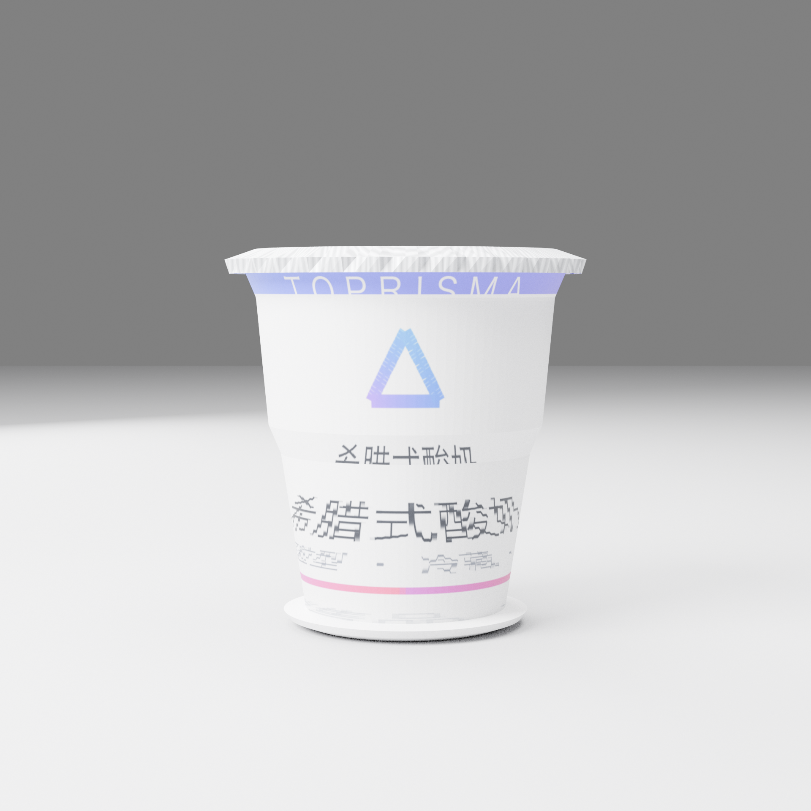
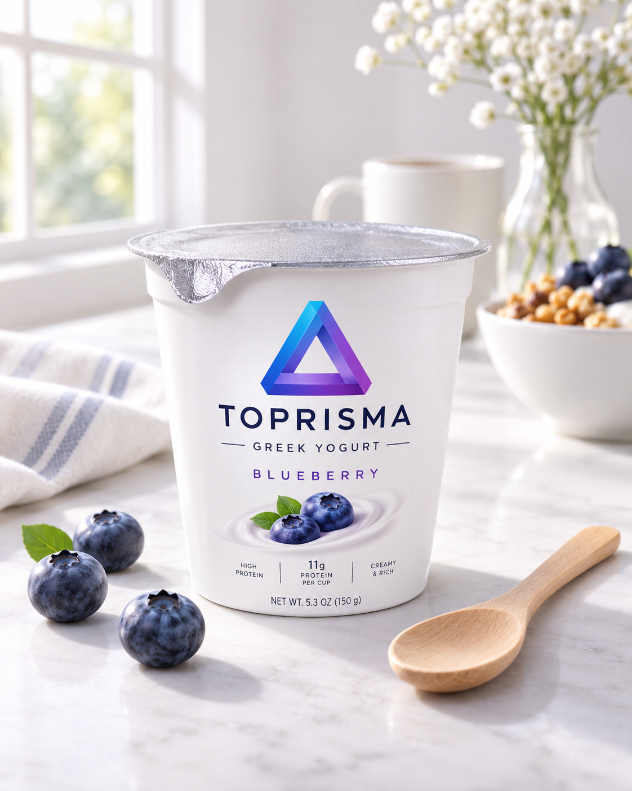
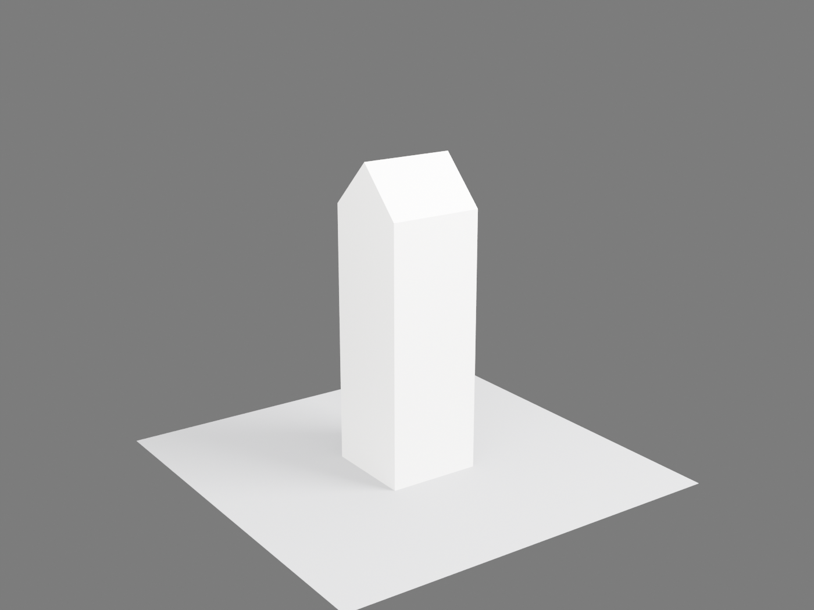

# OpenUSD 零售商品数字孪生与视觉 AI 研究仓

零售包装数字孪生的完整研究仓：**OpenUSD 数字母本 + Blender/Cycles(Metal-RT) 商业级渲染 + 货架 SDG 合成数据 + YOLO 训练评测闭环**，Apple Silicon (Mac) 100% 离线可跑。
对外展示资产使用自有品牌 **Toprisma® 虚拟产品**（虚拟演示 SKU，非在售）。

> **公开仓库资产与知识产权边界**：本仓库公开的产品包装、品牌标识、商品配置及展示资产均为自有或虚拟演示内容，不代表任何客户品牌、在售商品或商业合作关系。公开版本不包含客户提供的原始产品照片、品牌印刷文件、包装刀版及其他未获公开授权的客户专属素材。第三方模型、纹理及研究资料均按对应许可要求使用（见 docs/ASSET_CREDITS.md）。涉及历史研究的技术方法已做去标识化处理；公开演示流程不依赖未公开的客户专属素材（参照印刷层提升等私有工作流在公开仓模式下显式跳过并留痕）。

## 🧊 Toprisma® 虚拟产品线（公开展示资产）

<p align="center">
  
  
</p>
<p align="center">
  
</p>

**「Toprisma 希腊式酸奶 · 蓝莓 160g」（虚拟演示 SKU）**：设计母题=棱镜色散，蓝紫渐变三角 logo（#2F6BF0→#8B3CF0→#0090F0），标签/盖膜强制印制「虚拟演示产品 · 非销售品」。

- **程序化标签** `pipelines/toprisma_virtual/32_toprisma_yogurt_label.py` — PIL 矢量生成 2048×560 杯面实比贴图（中英混排/光谱条/占位条码）
- **参数化建模 + 渲染** `pipelines/toprisma_virtual/33_toprisma_yogurt_cup.py` — bmesh 锥度杯体 + 铝箔拱顶褶边盖，Cycles/Metal 1920px/256s（关 OIDN 保印刷笔画锐度）
- **AI 生活方式场景图** — ChatGPT relay 文生图早餐场景，品牌字样可读、无几何穿帮
- 详见 **[docs/GITHUB_SHOWCASE.md](docs/GITHUB_SHOWCASE.md)**

## 📁 研究案例

**① 参数化包装管线（公开 CC0 刀版核验协议）**
<p> </p>
左：CC0 公开刀版渲染参照；右：本仓 `pipelines/pack_dieline/` 标准管线生成。三级核验（许可原文/SSR 提取/2D 拓扑比对），spec JSON 声明 + 运行时几何求解。见 `docs/pack/gable_reference_benchmark.md`。

**② 商业棚拍级生活方式渲染**
以真实在售电商图为风格标尺校准的棚拍复刻线：f/5.6 + 9:1 光比 + 确定性噪声晶格（跨进程逐位一致）、11/11 门禁 + 8/8 接触影、真实扫描食材资产（蓝莓 CC-BY / 牛角包 CC0）入景。同标尺盲评**超过参照真图**（27 vs 25）。

**③ 货架 SDG + AI 巡检闭环**
零人工标注：相机射线网格像素级标签（负向对照验证）→ YOLOv11n MPS 训练 → 巡检仪表盘（OSA/合规率 KPI）。产能实测 3.6 图/min（bays=3 多联墙），1 万图水平可扩展。

**④ 合成 vs 真实四臂实证（公开数据集 SKU-110K，协议哈希存证）**
R0 真实基线 mAP@0.5 **0.886** / R2 真实+合成 **0.868**（Δ −1.8pp ≤ 2pp → **混合范式成立**：合成可替代大规模手工标注，前提=域对齐）；R1 纯合成 0.133 负结果披露（训练/真实密度错配根因坐实）。报告：[docs/research/benchmark/](docs/research/benchmark/)。

**⑤ 对标研究 — [联合利华 × NVIDIA Omniverse + 雀巢](docs/research/UNILEVER_NESTLE_BENCHMARK.md)（704 行）**
Unilever OpenUSD 商品孪生库官方口径（提速 ~2× / 成本 −50%）、雀巢 CGI 案例证据分级、数字孪生价值阶梯 L1–L5、国内乳品四类分化 gap 分析；含反例 Dove 真实摄影策略。技术谱系外部对标（SimReady/BlenderProc/Neurolabs/SKU-110K）综合 66/100 + 提分路线。

**⑥ 资产规范与 USD 容器化**
[docs/TWIN_ASSET_SPEC.md](docs/TWIN_ASSET_SPEC.md)：坐标尺度/UV atlas 32px 间隙/材质贴图契约/SimReady 元数据；`12_asset_spec_gate.py` 五闸（origin/topology/uv/atlas/export）+ 渲染五闸（stray geometry BFS/血缘 mtime）。

## 快速开始

```bash
# 0. 一键全链草档回归 (~2min): 贴图自举→电商套图→QA五闸→货架SDG→虚拟产品→刀版资产闸→账目
python3 run_pipeline.py --draft          # --full 跑全量; --keep-going 失败不中断; --only 阶段过滤
python3 run_pipeline.py --draft --with-train   # 接上 YOLO 臂: SDG数据集→YOLOv11n MPS 微调 (内存门: <10GB 拒跑, <18GB 限 watermark)

# 1. 程序化 PBR 贴图自举（2048² albedo+ORM+法线, ~2s, 零依赖）
python3 pipelines/bootstrap/00_bootstrap_textures.py

# 2. 四平台电商展示图 + AR 模型（Metal-RT, ~1-2min）
/Applications/Blender.app/Contents/MacOS/Blender -b -P pipelines/ecommerce/01_comfy_usd_compositor.py -- --sku demo_organic --scene grassland

# 3. 货架合成数据集 + AI 巡检仪表盘
/Applications/Blender.app/Contents/MacOS/Blender -b -P pipelines/shelf_sdg/02_shelf_sdg_inspector.py -- --num-images 20

# Toprisma 虚拟产品全链路
python3 pipelines/toprisma_virtual/32_toprisma_yogurt_label.py
/Applications/Blender.app/Contents/MacOS/Blender -b -P pipelines/toprisma_virtual/33_toprisma_yogurt_cup.py
```

## 工程结构

```
├── run_pipeline.py          一键编排器 (fail-fast/分阶段计时/闸门透传, --draft|--full)
├── pipelines/
│   ├── bootstrap/        程序化贴图自举 / 可选参照印刷层提升 / 1L 砖型贴图
│   ├── ecommerce/        电商套图矩阵 / 排版 QA 闸 / USD 资产 / 3D 查看器
│   ├── shelf_sdg/        货架仿真 / YOLO 训练 / 四臂实证 / 计数评测
│   ├── commercial/       商业棚拍渲染线（lifestyle/KV/门禁/掩膜/探针）
│   ├── pack_dieline/     刀版 → 参数化包装资产（spec 声明 + 求解器）
│   ├── toprisma_virtual/ 自有品牌虚拟 SKU 全链路（公开展示）
│   └── demo_stage/       交互工作台 / 礼盒端架 / 对比板 / 全景
├── specs/                场景与资产声明式 spec JSON
├── assets/               CC0/CC-BY 模型与贴图（来源见 docs/ASSET_CREDITS.md）
├── docs/                 规范 / 研究 / 基准报告 / 展示说明
└── templates/            汇报页模板
```

## 质量纪律（为什么这些分数可信）

- **同标尺盲评**：所有分数来自同一会话同一 rubric 的外部 LLM 评审，跨会话分数不可比
- **像素/数值验证优先**：视觉判断一律用代码复核（镜像方向、字形粘连、液流锥度均曾被视觉误报）
- **单变量轮次**：每轮只动一个变量，先证明装置本身改变超噪声地板（≈0.0007/255）再采信对比
- **负结果照实披露**：纯合成不迁移（0.133）、程序化重绘单调下滑（81→62）均入档

## 已知边界（诚实账目）

- 示例 SKU 档案为**演示用参数配置**（配色/营养数据/条码占位），不指向任何在售商品；脚本内部的示例 SKU 配置键与印刷文案沿用历史研究配置，属演示参数，不代表任何品牌合作或认可
- 2D 框 = 8 顶点投影（Cryptomatte 像素级紧致框为升级位）；物理掉落用解析微扰等效
- YOLO demo 20 张闭环足够，产线级需万张级（水平扩展即可）
- 渲染分数为主观标尺，定位是"技术能力证明"，不宣称"与真拍难辨"

## 技术栈

Pixar OpenUSD（.usdc/.usdz）· Blender 5.2 headless · Cycles Metal-RT + OIDN ·
Pillow/NumPy 程序化印刷 · YOLOv11n + PyTorch MPS · Streamlit · pxr USD 运行时
